<div dir="rtl">

<p align="center"></p>

<p align="center">
<a href="../../README.md"></a>
<a href="../../GiDo/RU-ru/README.md"></a>
<a href="../../GiDo/ZH-cn/README.md"></a>
<a href="../../GiDo/ES-es/README.md"></a>
<a href="../../GiDo/HI-in/README.md"></a>
<a href="../../GiDo/AR-sa/README.md"></a>
<a href="../../GiDo/FR-fr/README.md"></a>
<a href="../../GiDo/BN-bd/README.md"></a>
<a href="../../GiDo/PT-br/README.md"></a>
<a href="../../GiDo/UR-pk/README.md"></a>
<a href="../../GiDo/ID-id/README.md"></a>
<a href="../../GiDo/DE-de/README.md"></a>
<a href="../../GiDo/JA-jp/README.md"></a>
<a href="../../GiDo/TR-tr/README.md"></a>
<a href="../../GiDo/KO-kr/README.md"></a>
<a href="../../GiDo/VI-vn/README.md"></a>
<a href="../../GiDo/IT-it/README.md"></a>
<a href="../../GiDo/PL-pl/README.md"></a>
<a href="../../GiDo/UK-ua/README.md"></a>
<a href="../../GiDo/TH-th/README.md"></a>
</p>

<p align="center"><a href="https://github.com/Arkomiko/Fruity-Organizer-DataBase/releases/latest"><b>⬇ تنزيل FODB.exe</b></a></p>

منظّم محمول لقاعدة بيانات إضافات FL Studio. يرتّب الإضافات في مجلدات حسب الشركة المصنعة أو الغرض أو كليهما، بمظهر ينسجم مع FL Studio.

<p align="center"></p>

## الميزات

- الفرز حسب الشركة أو الغرض أو التداخل بأي ترتيب: الشركة\الغرض أو الغرض\الشركة
- يحدد الغرض من كل إضافة: صدى، معادل، ديناميكيات، مُركِّب و18 غرضًا آخر
- مرشحات حسب الغرض والشركة والتنسيق والبت والحالة وتاريخ الملف والحجم وغيرها
- يتبع سمة FL Studio الحالية مباشرةً
- نسخ احتياطية تلقائية، وتراجع بنقرة واحدة، ولا شيء يخرج من مجلد قاعدة البيانات
- ملف واحد بحجم 9 ميجابايت دون تثبيت، والإعدادات بجانبه
- 20 لغة للواجهة وإعدادات للتخطيطات والمفاتيح والمقياس والخطوط والألوان وغيرها

## البدء السريع

1. نزّل FODB.exe وشغّله. يُعثر على قاعدة بيانات الإضافات تلقائيًا.
2. اختر تخطيط المجلدات وفعّل المصادر والمرشحات التي تريدها.
3. اضغط «تنظيم الإضافات»، وراجع المعاينة، ثم حدّث متصفح الإضافات في FL Studio.

## تخطيطات المجلدات

<p align="center"></p>

اختر تخطيطًا جاهزًا أو اكتب قالبك من هذه الأجزاء:

```text
{vendor}  {purpose}  {format}  {bits}  {letter}  {kind}

{vendor}\{purpose}
{purpose}\{vendor}
USER\{format}\{vendor}
```

## المرشحات

حدد القيم في قائمة المرشحات أو اكتب الشروط في مربع البحث:

```text
purpose:reverb,delay                 reverb OR delay
vendor:"plugin alliance" -format:vst  one vendor, without VST2
organized:no kind:synth               synths not organized yet
age:30d bits:64                       64-bit, dated in the last 30 days
```

## سمات FL Studio

<p align="center"></p>

يقرأ FODB السمة النشطة ويحدّث ألوانه عند تغييرها في FL Studio. الألوان الأساسية قريبة جدًا لكنها ليست مطابقة تمامًا.

## الأمان

- لا تتغير إضافاتك أبدًا. في مجلد Installed قد تتغير قائمة New فقط: تخرج منها الإضافة المنظَّمة، ويمكن إيقاف ذلك.
- يمكن التراجع عن كل عملية، وتذهب الملفات المحذوفة إلى سلة المحذوفات.
- قبل كل تغيير تُنشأ نسخة ZIP احتياطية من القاعدة؛ تُحفظ أحدث 40 نسخة ويمكن تعديل العدد.

## قواعدك الخاصة

أضف قواعد من تبويب الإعدادات أو في FODB.json لتحديد الغرض حسب الاسم أو الشركة باستخدام التعابير النمطية:

```json
"purpose_rules": [
  { "purpose": "drums", "name": "kick|808" },
  { "purpose": "vocal", "vendor": "antares" }
]
```

## البناء من المصدر

يتطلب Windows وPython 3.13. يستخدم البرنامج المكتبة القياسية فقط.

```powershell
./build.ps1
```

## الشكر

مبني على FL Studio Automatic Plugin Organizer من Magabes والمساهمين، برخصة MIT.

مشروع مستقل لا يرتبط بشركة Image-Line. ‏FL Studio علامة تجارية لشركة Image-Line.

</div>
