<p align="center"></p>

<p align="center">
<a href="../../README.md"></a>
<a href="../../GiDo/RU-ru/README.md"></a>
<a href="../../GiDo/ZH-cn/README.md"></a>
<a href="../../GiDo/ES-es/README.md"></a>
<a href="../../GiDo/HI-in/README.md"></a>
<a href="../../GiDo/FR-fr/README.md"></a>
<a href="../../GiDo/BN-bd/README.md"></a>
<a href="../../GiDo/PT-br/README.md"></a>
<a href="../../GiDo/UR-pk/README.md"></a>
<a href="../../GiDo/ID-id/README.md"></a>
<a href="../../GiDo/DE-de/README.md"></a>
<a href="../../GiDo/JA-jp/README.md"></a>
<a href="../../GiDo/TR-tr/README.md"></a>
<a href="../../GiDo/KO-kr/README.md"></a>
<a href="../../GiDo/VI-vn/README.md"></a>
<a href="../../GiDo/IT-it/README.md"></a>
<a href="../../GiDo/PL-pl/README.md"></a>
<a href="../../GiDo/UK-ua/README.md"></a>
<a href="../../GiDo/TH-th/README.md"></a>
<a href="../../GiDo/KK-kz/README.md"></a>
<a href="../../GiDo/UZ-uz/README.md"></a>
<a href="../../GiDo/BE-by/README.md"></a>
<a href="../../GiDo/AZ-az/README.md"></a>
<a href="../../GiDo/HY-am/README.md"></a>
<a href="../../GiDo/ISV-sl/README.md"></a>
<a href="../../GiDo/HE-il/README.md"></a>
</p>

<p align="center"><a href="https://github.com/Arkomiko/Fruity-Organizer-DataBase/releases/latest"><b>⬇ FODB.exe yüklə</b></a> &nbsp;|&nbsp; <a href="https://arkomiko.github.io/Fruity-Organizer-DataBase/AZ-az/wiki/index.html"><b>Viki</b></a></p>

FL Studio plagin bazası üçün portativ orqanayzer. Plaginləri qovluqlara istehsalçı, təyinat və ya hər ikisinə görə düzür və FL Studio-nun öz hissəsi kimi görünür.

<p align="center"></p>

## İmkanlar

- İstehsalçı və ya təyinata görə sıralama, ya da istənilən ardıcıllıqla iç-içə: İstehsalçı\Təyinat və ya Təyinat\İstehsalçı
- Hər plaginin nə üçün olduğunu tapır: reverberasiya, ekvalayzer, dinamika, sintezator və daha 18 təyinat
- Təyinat, istehsalçı, format, bit, vəziyyət, fayl tarixi, ölçü və digər filtrlər
- Cari FL Studio mövzusunu dərhal tətbiq edir
- Avtomatik ehtiyat nüsxələr, bir kliklə geri alma, heç nə baza qovluğundan çıxmır
- Quraşdırmasız 10 MB bir fayl; tənzimləmələr onun yanında saxlanır
- 26 interfeys dili, həmçinin düzülüş, düymə, miqyas, şrift və rəng tənzimləmələri

## Sürətli başlanğıc

1. FODB.exe yükləyin və işə salın. Plagin bazası avtomatik tapılır.
2. Qovluq düzülüşünü seçin, mənbələri və filtrləri açın və ya bağlayın.
3. «Plaginləri nizamla» düyməsini basın, önbaxışı yoxlayın, sonra FL Studio-da plagin brauzerini yeniləyin.

## Qovluq düzülüşləri

<p align="center"></p>

Hazır düzülüşü seçin və ya bu hissələrdən öz şablonunuzu yazın:

```text
{vendor}  {purpose}  {format}  {bits}  {letter}  {kind}

{vendor}\{purpose}
{purpose}\{vendor}
USER\{format}\{vendor}
```

## Filtrlər

«Filtrlər» menyusunda dəyərləri işarələyin və ya axtarış sahəsinə şərtlər yazın:

```text
purpose:reverb,delay                 reverb OR delay
vendor:"plugin alliance" -format:vst  one vendor, without VST2
organized:no kind:synth               synths not organized yet
age:30d bits:64                       64-bit, dated in the last 30 days
```

## FL Studio mövzuları

<p align="center"></p>

FODB aktiv mövzunu oxuyur və FL Studio-da dəyişəndə rənglərini yeniləyir. Əsas rənglər çox yaxındır, lakin pikselə qədər uyğun deyil.

## Təhlükəsizlik

- Plaginləriniz dəyişmir. Installed qovluğunda yalnız New siyahısı dəyişə bilər: nizamlanan plagin ondan çıxır və bunu söndürmək olar.
- Hər işə salmanı geri almaq olar, silinən fayllar zibil qutusuna gedir.
- Hər dəyişiklikdən əvvəl bazanın ZIP nüsxəsi yaradılır; son 40-ı saxlanır, sayı dəyişmək olar.

## Öz qaydalarınız

«Tənzimləmələr» vərəqində və ya FODB.json-da qaydalar əlavə edib müntəzəm ifadələrlə ada və ya istehsalçıya görə təyinat verin:

```json
"purpose_rules": [
  { "purpose": "drums", "name": "kick|808" },
  { "purpose": "vocal", "vendor": "antares" }
]
```

## Mənbə kodundan yığma

Windows və Python 3.13 lazımdır. Proqramın özü yalnız standart kitabxanadan istifadə edir.

```powershell
./packaging/build.ps1
```

## Təşəkkür

Magabes və həmmüəlliflərin FL Studio Automatic Plugin Organizer proqramı əsasında, MIT lisenziyası ilə.

Image-Line ilə əlaqəsi olmayan müstəqil layihə. FL Studio Image-Line-ın ticarət nişanıdır.
