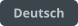

<p align="center"></p>

<p align="center">
<a href="../../README.md"></a>
<a href="../../GiDo/RU-ru/README.md"></a>
<a href="../../GiDo/ZH-cn/README.md"></a>
<a href="../../GiDo/ES-es/README.md"></a>
<a href="../../GiDo/HI-in/README.md"></a>
<a href="../../GiDo/FR-fr/README.md"></a>
<a href="../../GiDo/BN-bd/README.md"></a>
<a href="../../GiDo/PT-br/README.md"></a>
<a href="../../GiDo/UR-pk/README.md"></a>
<a href="../../GiDo/ID-id/README.md"></a>
<a href="../../GiDo/DE-de/README.md"></a>
<a href="../../GiDo/JA-jp/README.md"></a>
<a href="../../GiDo/TR-tr/README.md"></a>
<a href="../../GiDo/KO-kr/README.md"></a>
<a href="../../GiDo/VI-vn/README.md"></a>
<a href="../../GiDo/IT-it/README.md"></a>
<a href="../../GiDo/PL-pl/README.md"></a>
<a href="../../GiDo/UK-ua/README.md"></a>
<a href="../../GiDo/TH-th/README.md"></a>
<a href="../../GiDo/KK-kz/README.md"></a>
<a href="../../GiDo/UZ-uz/README.md"></a>
<a href="../../GiDo/BE-by/README.md"></a>
<a href="../../GiDo/AZ-az/README.md"></a>
<a href="../../GiDo/HY-am/README.md"></a>
<a href="../../GiDo/ISV-sl/README.md"></a>
<a href="../../GiDo/HE-il/README.md"></a>
</p>

<p align="center"><a href="https://github.com/Arkomiko/Fruity-Organizer-DataBase/releases/latest"><b>⬇ Спампаваць FODB.exe</b></a> &nbsp;|&nbsp; <a href="https://arkomiko.github.io/Fruity-Organizer-DataBase/BE-by/wiki/index.html"><b>Вікі</b></a></p>

Партатыўны арганайзер базы плагінаў FL Studio. Раскладвае плагіны па папках: па вытворцы, па прызначэнні або адразу па абодвух, а выглядае як родная частка FL Studio.

<p align="center"></p>

## Магчымасці

- Сартаванне па вытворцы, па прызначэнні або з укладзенасцю ў любым парадку: Вытворца\Прызначэнне або Прызначэнне\Вытворца
- Вызначае, для чаго патрэбны плагін: рэверберацыя, эквалайзер, дынаміка, сінтэзатар і яшчэ 18 прызначэнняў
- Фільтры па прызначэнні, вытворцы, фармаце, разраднасці, стане, даце файла, памеры і іншых прыкметах
- Падхоплівае бягучую тэму FL Studio на лета
- Аўтаматычныя бэкапы, адмена ў адзін клік, нічога не выходзіць за межы папкі базы
- Адзін файл на 10 МБ без усталявання; налады захоўваюцца побач з ім
- 26 моў інтэрфейсу і налады раскладак, клавіш, маштабу, шрыфтоў, колераў і не толькі

## Хуткі старт

1. Спампуйце FODB.exe і запусціце. База плагінаў знаходзіцца аўтаматычна.
2. Выберыце раскладку папак і ўключыце патрэбныя крыніцы і фільтры.
3. Націсніце «Арганізаваць плагіны», праверце папярэдні прагляд і абнавіце браўзер плагінаў у FL Studio.

## Раскладкі папак

<p align="center"></p>

Выберыце гатовую раскладку або напішыце свой шаблон з гэтых частак:

```text
{vendor}  {purpose}  {format}  {bits}  {letter}  {kind}

{vendor}\{purpose}
{purpose}\{vendor}
USER\{format}\{vendor}
```

## Фільтры

Адзначайце значэнні ў меню «Фільтры» або ўводзьце ўмовы ў поле пошуку:

```text
purpose:reverb,delay                 reverb OR delay
vendor:"plugin alliance" -format:vst  one vendor, without VST2
organized:no kind:synth               synths not organized yet
age:30d bits:64                       64-bit, dated in the last 30 days
```

## Тэмы FL Studio

<p align="center"></p>

FODB чытае актыўную тэму і перабудоўвае колеры, калі вы мяняеце яе ў FL Studio. Базавыя колеры вельмі блізкія да арыгінала, але не супадаюць да пікселя.

## Бяспека

- Вашы плагіны не мяняюцца. У папцы Installed можа змяніцца толькі спіс New: раскладзены плагін выходзіць з яго, і гэта можна выключыць.
- Любы запуск можна адмяніць, а файлы, што выдаляюцца, ідуць у сметніцу.
- Перад кожнай зменай ствараецца ZIP-бэкап базы; захоўваюцца 40 апошніх, колькасць можна змяніць.

## Свае правілы

Дадавайце правілы на ўкладцы «Налады» або ў FODB.json, каб задаваць прызначэнне па назве ці вытворцы рэгулярнымі выразамі:

```json
"purpose_rules": [
  { "purpose": "drums", "name": "kick|808" },
  { "purpose": "vocal", "vendor": "antares" }
]
```

## Зборка з зыходнікаў

Патрэбныя Windows і Python 3.13. Сама праграма выкарыстоўвае толькі стандартную бібліятэку.

```powershell
./build.ps1
```

## Падзякі

Заснавана на FL Studio Automatic Plugin Organizer ад Magabes і сааўтараў, ліцэнзія MIT.

Незалежны праект, не звязаны з Image-Line. FL Studio з'яўляецца таварным знакам Image-Line.
