<p align="center"></p>

<p align="center">
<a href="../../README.md"></a>
<a href="../../GiDo/RU-ru/README.md"></a>
<a href="../../GiDo/ZH-cn/README.md"></a>
<a href="../../GiDo/ES-es/README.md"></a>
<a href="../../GiDo/HI-in/README.md"></a>
<a href="../../GiDo/FR-fr/README.md"></a>
<a href="../../GiDo/BN-bd/README.md"></a>
<a href="../../GiDo/PT-br/README.md"></a>
<a href="../../GiDo/UR-pk/README.md"></a>
<a href="../../GiDo/ID-id/README.md"></a>
<a href="../../GiDo/DE-de/README.md"></a>
<a href="../../GiDo/JA-jp/README.md"></a>
<a href="../../GiDo/TR-tr/README.md"></a>
<a href="../../GiDo/KO-kr/README.md"></a>
<a href="../../GiDo/VI-vn/README.md"></a>
<a href="../../GiDo/IT-it/README.md"></a>
<a href="../../GiDo/PL-pl/README.md"></a>
<a href="../../GiDo/UK-ua/README.md"></a>
<a href="../../GiDo/TH-th/README.md"></a>
<a href="../../GiDo/KK-kz/README.md"></a>
<a href="../../GiDo/UZ-uz/README.md"></a>
<a href="../../GiDo/BE-by/README.md"></a>
<a href="../../GiDo/AZ-az/README.md"></a>
<a href="../../GiDo/HY-am/README.md"></a>
<a href="../../GiDo/ISV-sl/README.md"></a>
<a href="../../GiDo/HE-il/README.md"></a>
</p>

<p align="center"><a href="https://github.com/Arkomiko/Fruity-Organizer-DataBase/releases/latest"><b>⬇ FODB.exe ডাউনলোড করুন</b></a> &nbsp;|&nbsp; <a href="https://arkomiko.github.io/Fruity-Organizer-DataBase/BN-bd/wiki/index.html"><b>উইকি</b></a> &nbsp;|&nbsp; <a href="https://github.com/Arkomiko/Fruity-Organizer-DataBase/blob/main/GiDo/ROADMAP.md"><b>Roadmap</b></a></p>

FL Studio প্লাগইন ডেটাবেসের জন্য একটি পোর্টেবল অর্গানাইজার। এটি প্লাগইনগুলোকে নির্মাতা, ব্যবহার বা উভয় অনুযায়ী ফোল্ডারে সাজায় এবং FL Studio-র সঙ্গে মানানসই দেখায়।

<p align="center"></p>

## বৈশিষ্ট্য

- নির্মাতা বা ব্যবহার অনুযায়ী সাজান, অথবা যেকোনো ক্রমে নেস্ট করুন: নির্মাতা\ব্যবহার বা ব্যবহার\নির্মাতা
- প্লাগইনটি কী কাজের তা চিহ্নিত করে: রিভার্ব, EQ, ডায়নামিক্স, সিন্থ ও আরও ১৮টি ব্যবহার
- ব্যবহার, নির্মাতা, ফরম্যাট, বিট, অবস্থা, ফাইলের তারিখ, আকার ইত্যাদির ফিল্টার
- FL Studio-র বর্তমান থিম সঙ্গে সঙ্গে অনুসরণ করে
- স্বয়ংক্রিয় ব্যাকআপ, এক ক্লিকে পূর্বাবস্থা, কিছুই ডেটাবেস ফোল্ডারের বাইরে যায় না
- ৯ MB-র একটি ফাইল, ইনস্টলেশন লাগে না; সেটিংস তার পাশেই থাকে
- 26টি ইন্টারফেস ভাষা এবং বিন্যাস, হটকি, স্কেল, ফন্ট, রং ইত্যাদির সেটিংস

## দ্রুত শুরু

1. FODB.exe ডাউনলোড করে চালান। প্লাগইন ডেটাবেস স্বয়ংক্রিয়ভাবে পাওয়া যায়।
2. ফোল্ডার লেআউট বেছে নিন এবং উৎস ও ফিল্টার চালু বা বন্ধ করুন।
3. «প্লাগইন সাজান» চাপুন, প্রিভিউ দেখুন, তারপর FL Studio-তে প্লাগইন ব্রাউজার রিফ্রেশ করুন।

## ফোল্ডার লেআউট

<p align="center"></p>

একটি প্রিসেট বেছে নিন অথবা এই অংশগুলো দিয়ে নিজের টেমপ্লেট লিখুন:

```text
{vendor}  {purpose}  {format}  {bits}  {letter}  {kind}

{vendor}\{purpose}
{purpose}\{vendor}
USER\{format}\{vendor}
```

## ফিল্টার

ফিল্টার মেনুতে মান নির্বাচন করুন অথবা অনুসন্ধান বাক্সে শর্ত লিখুন:

```text
purpose:reverb,delay                 reverb OR delay
vendor:"plugin alliance" -format:vst  one vendor, without VST2
organized:no kind:synth               synths not organized yet
age:30d bits:64                       64-bit, dated in the last 30 days
```

## FL Studio থিম

<p align="center"></p>

FODB সক্রিয় থিম পড়ে এবং FL Studio-তে বদলালে নিজের রং হালনাগাদ করে। মূল রংগুলো খুব কাছাকাছি, তবে পিক্সেল-নিখুঁত নয়।

## নিরাপত্তা

- আপনার প্লাগইন কখনও বদলায় না। Installed ফোল্ডারে শুধু New তালিকা বদলাতে পারে: সাজানো প্লাগইন সেখান থেকে সরে যায়, এবং এটি বন্ধ করা যায়।
- প্রতিটি রান পূর্বাবস্থায় ফেরানো যায়, আর সরানো ফাইল রিসাইকেল বিনে যায়।
- প্রতিটি পরিবর্তনের আগে ডেটাবেসের ZIP ব্যাকআপ তৈরি হয়; সর্বশেষ 40টি থাকে এবং সংখ্যাটি বদলানো যায়।

## নিজের নিয়ম

সেটিংস ট্যাবে বা FODB.json-এ নিয়ম যোগ করে রেগুলার এক্সপ্রেশনে নাম বা প্রস্তুতকারক অনুযায়ী ব্যবহার ঠিক করুন:

```json
"purpose_rules": [
  { "purpose": "drums", "name": "kick|808" },
  { "purpose": "vocal", "vendor": "antares" }
]
```

## সোর্স থেকে বিল্ড

Windows ও Python 3.13 প্রয়োজন। প্রোগ্রামটি কেবল স্ট্যান্ডার্ড লাইব্রেরি ব্যবহার করে।

```powershell
./packaging/build.ps1
```

## কৃতজ্ঞতা

Magabes ও সহযোগীদের FL Studio Automatic Plugin Organizer-এর ওপর ভিত্তি করে, MIT লাইসেন্সে।

স্বাধীন প্রকল্প, Image-Line-এর সঙ্গে সম্পর্কিত নয়। FL Studio হলো Image-Line-এর ট্রেডমার্ক।
