<p align="center"></p>

<p align="center">
<a href="../../README.md"></a>
<a href="../../GiDo/RU-ru/README.md"></a>
<a href="../../GiDo/ZH-cn/README.md"></a>
<a href="../../GiDo/ES-es/README.md"></a>
<a href="../../GiDo/HI-in/README.md"></a>
<a href="../../GiDo/FR-fr/README.md"></a>
<a href="../../GiDo/BN-bd/README.md"></a>
<a href="../../GiDo/PT-br/README.md"></a>
<a href="../../GiDo/UR-pk/README.md"></a>
<a href="../../GiDo/ID-id/README.md"></a>
<a href="../../GiDo/DE-de/README.md"></a>
<a href="../../GiDo/JA-jp/README.md"></a>
<a href="../../GiDo/TR-tr/README.md"></a>
<a href="../../GiDo/KO-kr/README.md"></a>
<a href="../../GiDo/VI-vn/README.md"></a>
<a href="../../GiDo/IT-it/README.md"></a>
<a href="../../GiDo/PL-pl/README.md"></a>
<a href="../../GiDo/UK-ua/README.md"></a>
<a href="../../GiDo/TH-th/README.md"></a>
<a href="../../GiDo/KK-kz/README.md"></a>
<a href="../../GiDo/UZ-uz/README.md"></a>
<a href="../../GiDo/BE-by/README.md"></a>
<a href="../../GiDo/AZ-az/README.md"></a>
<a href="../../GiDo/HY-am/README.md"></a>
<a href="../../GiDo/ISV-sl/README.md"></a>
<a href="../../GiDo/HE-il/README.md"></a>
</p>

<p align="center"><a href="https://github.com/Arkomiko/Fruity-Organizer-DataBase/releases/latest"><b>⬇ FODB.exe herunterladen</b></a> &nbsp;|&nbsp; <a href="https://arkomiko.github.io/Fruity-Organizer-DataBase/DE-de/wiki/index.html"><b>Wiki</b></a></p>

Ein portabler Organizer für die Plugin-Datenbank von FL Studio. Er sortiert Plugins nach Hersteller, Einsatzzweck oder beidem in Ordner und fügt sich optisch in FL Studio ein.

<p align="center"></p>

## Funktionen

- Sortieren nach Hersteller, nach Zweck oder verschachtelt in beliebiger Reihenfolge: Hersteller\Zweck oder Zweck\Hersteller
- Erkennt den Zweck jedes Plugins: Reverb, EQ, Dynamik, Synth und 18 weitere
- Filter für Zweck, Hersteller, Format, Bit, Status, Dateidatum, Größe und mehr
- Folgt live dem aktuellen FL-Studio-Theme
- Automatische Backups, Rückgängig mit einem Klick, nichts verlässt den Datenbankordner
- Eine einzige 10-MB-Datei ohne Installation; die Einstellungen liegen daneben
- 26 Oberflächensprachen sowie Einstellungen für Anordnung, Kürzel, Skalierung, Schriften, Farben und mehr

## Schnellstart

1. FODB.exe herunterladen und starten. Die Plugin-Datenbank wird automatisch gefunden.
2. Ordnerstruktur wählen und Quellen sowie Filter ein- oder ausschalten.
3. „Plugins organisieren“ drücken, Vorschau prüfen und den Plugin-Browser in FL Studio aktualisieren.

## Ordnerstrukturen

<p align="center"></p>

Wähle eine Vorlage oder schreibe eine eigene aus diesen Teilen:

```text
{vendor}  {purpose}  {format}  {bits}  {letter}  {kind}

{vendor}\{purpose}
{purpose}\{vendor}
USER\{format}\{vendor}
```

## Filter

Werte im Filtermenü ankreuzen oder Bedingungen ins Suchfeld eingeben:

```text
purpose:reverb,delay                 reverb OR delay
vendor:"plugin alliance" -format:vst  one vendor, without VST2
organized:no kind:synth               synths not organized yet
age:30d bits:64                       64-bit, dated in the last 30 days
```

## FL-Studio-Themes

<p align="center"></p>

FODB liest das aktive Theme und aktualisiert seine Farben, wenn du es in FL Studio änderst. Die Grundfarben sind sehr ähnlich, aber nicht pixelgenau.

## Sicherheit

- Deine Plugins werden nie verändert. Im Ordner Installed kann sich nur die Liste New ändern: Ein einsortiertes Plugin verlässt sie, das lässt sich abschalten.
- Jeder Durchlauf lässt sich rückgängig machen, entfernte Dateien landen im Papierkorb.
- Vor jeder Änderung entsteht ein ZIP-Backup der Datenbank; die neuesten 40 bleiben erhalten, die Anzahl ist einstellbar.

## Eigene Regeln

Füge auf der Registerkarte „Einstellungen“ oder in FODB.json Regeln hinzu, um den Zweck per regulärem Ausdruck nach Name oder Hersteller festzulegen:

```json
"purpose_rules": [
  { "purpose": "drums", "name": "kick|808" },
  { "purpose": "vocal", "vendor": "antares" }
]
```

## Aus dem Quellcode bauen

Benötigt Windows und Python 3.13. Das Programm nutzt nur die Standardbibliothek.

```powershell
./build.ps1
```

## Danksagung

Basiert auf FL Studio Automatic Plugin Organizer von Magabes und Mitwirkenden, unter der MIT-Lizenz.

Unabhängiges Projekt ohne Verbindung zu Image-Line. FL Studio ist eine Marke von Image-Line.
