<p align="center"></p>

<p align="center">
<a href="../../README.md"></a>
<a href="../../GiDo/RU-ru/README.md"></a>
<a href="../../GiDo/ZH-cn/README.md"></a>
<a href="../../GiDo/ES-es/README.md"></a>
<a href="../../GiDo/HI-in/README.md"></a>
<a href="../../GiDo/FR-fr/README.md"></a>
<a href="../../GiDo/BN-bd/README.md"></a>
<a href="../../GiDo/PT-br/README.md"></a>
<a href="../../GiDo/UR-pk/README.md"></a>
<a href="../../GiDo/ID-id/README.md"></a>
<a href="../../GiDo/DE-de/README.md"></a>
<a href="../../GiDo/JA-jp/README.md"></a>
<a href="../../GiDo/TR-tr/README.md"></a>
<a href="../../GiDo/KO-kr/README.md"></a>
<a href="../../GiDo/VI-vn/README.md"></a>
<a href="../../GiDo/IT-it/README.md"></a>
<a href="../../GiDo/PL-pl/README.md"></a>
<a href="../../GiDo/UK-ua/README.md"></a>
<a href="../../GiDo/TH-th/README.md"></a>
<a href="../../GiDo/KK-kz/README.md"></a>
<a href="../../GiDo/UZ-uz/README.md"></a>
<a href="../../GiDo/BE-by/README.md"></a>
<a href="../../GiDo/AZ-az/README.md"></a>
<a href="../../GiDo/HY-am/README.md"></a>
<a href="../../GiDo/ISV-sl/README.md"></a>
<a href="../../GiDo/HE-il/README.md"></a>
</p>

<p align="center"><a href="https://github.com/Arkomiko/Fruity-Organizer-DataBase/releases/latest"><b>⬇ Descargar FODB.exe</b></a> &nbsp;|&nbsp; <a href="https://arkomiko.github.io/Fruity-Organizer-DataBase/ES-es/wiki/index.html"><b>Wiki</b></a></p>

Un organizador portátil para la base de datos de plugins de FL Studio. Ordena los plugins en carpetas por fabricante, por función o por ambos, con un aspecto que encaja con FL Studio.

<p align="center"></p>

## Funciones

- Ordena por fabricante, por función o anida en cualquier orden: Fabricante\Función o Función\Fabricante
- Detecta para qué sirve cada plugin: reverb, ecualizador, dinámica, sintetizador y 18 funciones más
- Filtros por función, fabricante, formato, bits, estado, fecha de archivo, tamaño y más
- Sigue el tema actual de FL Studio en tiempo real
- Copias de seguridad automáticas, deshacer con un clic, nada sale de la carpeta de la base de datos
- Un solo archivo de 10 MB sin instalación; los ajustes se guardan a su lado
- 26 idiomas de interfaz y ajustes de distribución, atajos, escala, fuentes, colores y más

## Inicio rápido

1. Descarga FODB.exe y ejecútalo. La base de datos de plugins se encuentra automáticamente.
2. Elige una disposición de carpetas y activa las fuentes y los filtros que quieras.
3. Pulsa «Organizar plugins», revisa la vista previa y actualiza el explorador de plugins en FL Studio.

## Disposiciones de carpetas

<p align="center"></p>

Elige una predefinida o escribe tu plantilla con estas partes:

```text
{vendor}  {purpose}  {format}  {bits}  {letter}  {kind}

{vendor}\{purpose}
{purpose}\{vendor}
USER\{format}\{vendor}
```

## Filtros

Marca valores en el menú Filtros o escribe condiciones en el cuadro de búsqueda:

```text
purpose:reverb,delay                 reverb OR delay
vendor:"plugin alliance" -format:vst  one vendor, without VST2
organized:no kind:synth               synths not organized yet
age:30d bits:64                       64-bit, dated in the last 30 days
```

## Temas de FL Studio

<p align="center"></p>

FODB lee el tema activo y actualiza sus colores cuando lo cambias en FL Studio. Los colores base son muy parecidos, pero no idénticos al píxel.

## Seguridad

- Tus plugins nunca se modifican. En la carpeta Installed solo puede cambiar la lista New: el plugin organizado sale de ella, y esto se puede desactivar.
- Cada ejecución se puede deshacer y los archivos eliminados van a la Papelera.
- Antes de cada cambio se crea una copia ZIP de la base; se conservan las 40 más recientes y el número es ajustable.

## Tus propias reglas

Añade reglas en la pestaña Ajustes o en FODB.json para definir el uso por nombre o fabricante con expresiones regulares:

```json
"purpose_rules": [
  { "purpose": "drums", "name": "kick|808" },
  { "purpose": "vocal", "vendor": "antares" }
]
```

## Compilar desde el código

Necesita Windows y Python 3.13. El programa solo usa la biblioteca estándar.

```powershell
./build.ps1
```

## Créditos

Basado en FL Studio Automatic Plugin Organizer de Magabes y colaboradores, con licencia MIT.

Proyecto independiente, sin relación con Image-Line. FL Studio es una marca de Image-Line.
