<p align="center"></p>

<div align="center">

<details><summary><b>Langue: Français</b> (26)</summary>

<table><tr><td><a href="../../README.md"> English</a></td><td><a href="../../GiDo/RU-ru/README.md"> Русский</a></td><td><a href="../../GiDo/ZH-cn/README.md"> 简体中文</a></td><td><a href="../../GiDo/ES-es/README.md"> Español</a></td><td><a href="../../GiDo/HI-in/README.md"> हिन्दी</a></td></tr><tr><td><b> Français</b></td><td><a href="../../GiDo/BN-bd/README.md"> বাংলা</a></td><td><a href="../../GiDo/PT-br/README.md"> Português</a></td><td><a href="../../GiDo/UR-pk/README.md"> اردو</a></td><td><a href="../../GiDo/ID-id/README.md"> Indonesia</a></td></tr><tr><td><a href="../../GiDo/DE-de/README.md"> Deutsch</a></td><td><a href="../../GiDo/JA-jp/README.md"> 日本語</a></td><td><a href="../../GiDo/TR-tr/README.md"> Türkçe</a></td><td><a href="../../GiDo/KO-kr/README.md"> 한국어</a></td><td><a href="../../GiDo/VI-vn/README.md"> Tiếng Việt</a></td></tr><tr><td><a href="../../GiDo/IT-it/README.md"> Italiano</a></td><td><a href="../../GiDo/PL-pl/README.md"> Polski</a></td><td><a href="../../GiDo/UK-ua/README.md"> Українська</a></td><td><a href="../../GiDo/TH-th/README.md"> ไทย</a></td><td><a href="../../GiDo/KK-kz/README.md"> Қазақша</a></td></tr><tr><td><a href="../../GiDo/UZ-uz/README.md"> Oʻzbekcha</a></td><td><a href="../../GiDo/BE-by/README.md"> Беларуская</a></td><td><a href="../../GiDo/AZ-az/README.md"> Azərbaycanca</a></td><td><a href="../../GiDo/HY-am/README.md"> Հայերեն</a></td><td><a href="../../GiDo/ISV-sl/README.md"> Medžuslovjansky</a></td></tr><tr><td><a href="../../GiDo/HE-il/README.md"> עברית</a></td></tr></table>
</details>

</div>

<p align="center"><a href="https://github.com/Arkomiko/Fruity-Organizer-DataBase/releases/latest"><b>⬇ Télécharger FODB.exe</b></a> &nbsp;|&nbsp; <a href="https://arkomiko.github.io/Fruity-Organizer-DataBase/FR-fr/wiki/index.html"><b>Wiki</b></a> &nbsp;|&nbsp; <a href="https://github.com/Arkomiko/Fruity-Organizer-DataBase/blob/main/GiDo/ROADMAP.md"><b>Roadmap</b></a></p>

<p align="center">By <a href="https://arkomiko.net"><b>Arkomiko</b></a></p>

Un organiseur portable pour la base de plugins de FL Studio. Il range les plugins dans des dossiers par éditeur, par usage ou les deux, avec une apparence qui s'accorde à FL Studio.

<p align="center"></p>

## Fonctionnalités

- Tri par éditeur, par usage ou imbriqué dans l'ordre voulu : Éditeur\Usage ou Usage\Éditeur
- Détermine l'usage de chaque plugin : réverbe, égaliseur, dynamique, synthé et 18 autres
- Filtres par usage, éditeur, format, bits, état, date de fichier, taille et plus
- Suit le thème actuel de FL Studio en direct
- Sauvegardes automatiques, annulation en un clic, rien ne sort du dossier de la base
- Un seul fichier de 10 Mo sans installation ; les réglages restent à côté
- 26 langues d'interface et des réglages de disposition, raccourcis, échelle, polices, couleurs et plus
- Mods facultatifs : une liste de plugins plus large, un catalogue ouvert, des usages plus fins qui apprennent de vous, un arbre d'aperçu et des repères d'état. À activer dans Paramètres, Données.

## Démarrage rapide

1. Téléchargez FODB.exe et lancez-le. La base de plugins est trouvée automatiquement.
2. Choisissez une disposition de dossiers et activez les sources et filtres voulus.
3. Cliquez sur « Organiser les plugins », vérifiez l'aperçu, puis actualisez le navigateur de plugins dans FL Studio.

## Dispositions de dossiers

<p align="center"></p>

Choisissez un préréglage ou écrivez votre modèle avec ces éléments :

```text
{vendor}  {purpose}  {format}  {bits}  {letter}  {kind}

{vendor}\{purpose}
{purpose}\{vendor}
USER\{format}\{vendor}
```

## Filtres

Cochez des valeurs dans le menu Filtres ou tapez des conditions dans la recherche :

```text
purpose:reverb,delay                 reverb OR delay
vendor:"plugin alliance" -format:vst  one vendor, without VST2
organized:no kind:synth               synths not organized yet
age:30d bits:64                       64-bit, dated in the last 30 days
```

## Thèmes FL Studio

<p align="center"></p>

FODB lit le thème actif et met à jour ses couleurs quand vous le changez dans FL Studio. Les couleurs de base sont très proches, sans être identiques au pixel près.

## Sécurité

- Vos plugins ne sont jamais modifiés. Dans le dossier Installed, seule la liste New peut changer : un plugin rangé la quitte, et cela peut être désactivé.
- Chaque opération peut être annulée et les fichiers retirés vont à la corbeille.
- Une sauvegarde ZIP de la base est créée avant chaque modification ; les 40 plus récentes sont conservées, nombre réglable.

## Vos propres règles

Ajoutez des règles dans l'onglet Paramètres ou dans FODB.json pour définir l'usage par nom ou éditeur, avec des expressions régulières :

```json
"purpose_rules": [
  { "purpose": "drums", "name": "kick|808" },
  { "purpose": "vocal", "vendor": "antares" }
]
```

## Compiler depuis les sources

Nécessite Windows et Python 3.13. Le programme n'utilise que la bibliothèque standard.

```powershell
./packaging/build.ps1
```

## Remerciements

Basé sur FL Studio Automatic Plugin Organizer de Magabes et ses contributeurs, sous licence MIT.

Projet indépendant, sans lien avec Image-Line. FL Studio est une marque d'Image-Line.
