<div dir="rtl">

<p align="center"></p>

<p align="center">
<a href="../../README.md"></a>
<a href="../../GiDo/RU-ru/README.md"></a>
<a href="../../GiDo/ZH-cn/README.md"></a>
<a href="../../GiDo/ES-es/README.md"></a>
<a href="../../GiDo/HI-in/README.md"></a>
<a href="../../GiDo/FR-fr/README.md"></a>
<a href="../../GiDo/BN-bd/README.md"></a>
<a href="../../GiDo/PT-br/README.md"></a>
<a href="../../GiDo/UR-pk/README.md"></a>
<a href="../../GiDo/ID-id/README.md"></a>
<a href="../../GiDo/DE-de/README.md"></a>
<a href="../../GiDo/JA-jp/README.md"></a>
<a href="../../GiDo/TR-tr/README.md"></a>
<a href="../../GiDo/KO-kr/README.md"></a>
<a href="../../GiDo/VI-vn/README.md"></a>
<a href="../../GiDo/IT-it/README.md"></a>
<a href="../../GiDo/PL-pl/README.md"></a>
<a href="../../GiDo/UK-ua/README.md"></a>
<a href="../../GiDo/TH-th/README.md"></a>
<a href="../../GiDo/KK-kz/README.md"></a>
<a href="../../GiDo/UZ-uz/README.md"></a>
<a href="../../GiDo/BE-by/README.md"></a>
<a href="../../GiDo/AZ-az/README.md"></a>
<a href="../../GiDo/HY-am/README.md"></a>
<a href="../../GiDo/ISV-sl/README.md"></a>
<a href="../../GiDo/HE-il/README.md"></a>
</p>

<p align="center"><a href="https://github.com/Arkomiko/Fruity-Organizer-DataBase/releases/latest"><b>⬇ הורדת FODB.exe</b></a> &nbsp;|&nbsp; <a href="https://arkomiko.github.io/Fruity-Organizer-DataBase/HE-il/wiki/index.html"><b>ויקי</b></a></p>

מארגן נייד למאגר התוספים של FL Studio. ממיין תוספים לתיקיות לפי יצרן, לפי ייעוד או לפי שניהם, ונראה כחלק טבעי מ-FL Studio.

<p align="center"></p>

## תכונות

- מיון לפי יצרן, לפי ייעוד או בקינון בכל סדר: יצרן\ייעוד או ייעוד\יצרן
- מזהה למה משמש כל תוסף: הדהוד, אקולייזר, דינמיקה, סינתיסייזר ועוד 18 ייעודים
- מסננים לפי ייעוד, יצרן, פורמט, ביטים, מצב, תאריך קובץ, גודל ועוד
- עוקב בזמן אמת אחרי ערכת הנושא הנוכחית של FL Studio
- גיבויים אוטומטיים, ביטול בלחיצה אחת, שום דבר לא יוצא מתיקיית המאגר
- קובץ אחד של 10 MB ללא התקנה; ההגדרות נשמרות לידו
- 26 שפות ממשק והגדרות לסידור, מקשים, קנה מידה, גופנים, צבעים ועוד

## התחלה מהירה

1. הורד את FODB.exe והפעל אותו. מאגר התוספים נמצא אוטומטית.
2. בחר סידור תיקיות והפעל או כבה מקורות ומסננים.
3. לחץ על «ארגן תוספים», בדוק את התצוגה המקדימה ורענן את דפדפן התוספים ב-FL Studio.

## סידורי תיקיות

<p align="center"></p>

בחר סידור מוכן או כתוב תבנית משלך מהחלקים האלה:

```text
{vendor}  {purpose}  {format}  {bits}  {letter}  {kind}

{vendor}\{purpose}
{purpose}\{vendor}
USER\{format}\{vendor}
```

## מסננים

סמן ערכים בתפריט «מסננים» או הקלד תנאים בשדה החיפוש:

```text
purpose:reverb,delay                 reverb OR delay
vendor:"plugin alliance" -format:vst  one vendor, without VST2
organized:no kind:synth               synths not organized yet
age:30d bits:64                       64-bit, dated in the last 30 days
```

## ערכות נושא של FL Studio

<p align="center"></p>

FODB קורא את ערכת הנושא הפעילה ומעדכן את הצבעים כשמשנים אותה ב-FL Studio. צבעי הבסיס קרובים מאוד, אך לא זהים ברמת הפיקסל.

## בטיחות

- התוספים שלך לעולם לא משתנים. בתיקיית Installed רק רשימת New יכולה להשתנות: תוסף מאורגן יוצא ממנה, ואפשר לכבות זאת.
- אפשר לבטל כל הרצה, וקבצים שהוסרו עוברים לסל המיחזור.
- לפני כל שינוי נוצר גיבוי ZIP של המאגר; נשמרים 40 האחרונים, ואפשר לשנות את המספר.

## כללים משלך

הוסף כללים בכרטיסייה «הגדרות» או ב-FODB.json כדי לקבוע ייעוד לפי שם או יצרן באמצעות ביטויים רגולריים:

```json
"purpose_rules": [
  { "purpose": "drums", "name": "kick|808" },
  { "purpose": "vocal", "vendor": "antares" }
]
```

## בנייה מקוד המקור

נדרשים Windows ו-Python 3.13. התוכנה עצמה משתמשת רק בספרייה הסטנדרטית.

```powershell
./packaging/build.ps1
```

## תודות

מבוסס על FL Studio Automatic Plugin Organizer מאת Magabes ותורמים, ברישיון MIT.

פרויקט עצמאי שאינו קשור ל-Image-Line. FL Studio הוא סימן מסחרי של Image-Line.

</div>
