<p align="center"></p>

<p align="center">
<a href="../../README.md"></a>
<a href="../../GiDo/RU-ru/README.md"></a>
<a href="../../GiDo/ZH-cn/README.md"></a>
<a href="../../GiDo/ES-es/README.md"></a>
<a href="../../GiDo/HI-in/README.md"></a>
<a href="../../GiDo/FR-fr/README.md"></a>
<a href="../../GiDo/BN-bd/README.md"></a>
<a href="../../GiDo/PT-br/README.md"></a>
<a href="../../GiDo/UR-pk/README.md"></a>
<a href="../../GiDo/ID-id/README.md"></a>
<a href="../../GiDo/DE-de/README.md"></a>
<a href="../../GiDo/JA-jp/README.md"></a>
<a href="../../GiDo/TR-tr/README.md"></a>
<a href="../../GiDo/KO-kr/README.md"></a>
<a href="../../GiDo/VI-vn/README.md"></a>
<a href="../../GiDo/IT-it/README.md"></a>
<a href="../../GiDo/PL-pl/README.md"></a>
<a href="../../GiDo/UK-ua/README.md"></a>
<a href="../../GiDo/TH-th/README.md"></a>
<a href="../../GiDo/KK-kz/README.md"></a>
<a href="../../GiDo/UZ-uz/README.md"></a>
<a href="../../GiDo/BE-by/README.md"></a>
<a href="../../GiDo/AZ-az/README.md"></a>
<a href="../../GiDo/HY-am/README.md"></a>
<a href="../../GiDo/ISV-sl/README.md"></a>
<a href="../../GiDo/HE-il/README.md"></a>
</p>

<p align="center"><a href="https://github.com/Arkomiko/Fruity-Organizer-DataBase/releases/latest"><b>⬇ FODB.exe डाउनलोड करें</b></a> &nbsp;|&nbsp; <a href="https://arkomiko.github.io/Fruity-Organizer-DataBase/HI-in/wiki/index.html"><b>विकी</b></a></p>

FL Studio प्लगइन डेटाबेस के लिए एक पोर्टेबल ऑर्गनाइज़र। यह प्लगइन को निर्माता, उपयोग या दोनों के अनुसार फ़ोल्डरों में रखता है और FL Studio के साथ घुल-मिल जाता है।

<p align="center"></p>

## विशेषताएँ

- निर्माता या उपयोग के अनुसार छाँटें, या किसी भी क्रम में नेस्ट करें: निर्माता\उपयोग या उपयोग\निर्माता
- पहचानता है कि प्लगइन किस काम का है: रिवर्ब, EQ, डायनेमिक्स, सिंथ और 18 अन्य उपयोग
- उपयोग, निर्माता, फ़ॉर्मेट, बिट, स्थिति, फ़ाइल तिथि, आकार आदि के फ़िल्टर
- FL Studio की मौजूदा थीम का तुरंत अनुसरण करता है
- स्वचालित बैकअप, एक क्लिक में पूर्ववत, कुछ भी डेटाबेस फ़ोल्डर से बाहर नहीं जाता
- 10 MB की एक फ़ाइल, इंस्टॉलेशन की ज़रूरत नहीं; सेटिंग्स उसी के पास रहती हैं
- 26 इंटरफ़ेस भाषाएँ और लेआउट, हॉटकी, स्केल, फ़ॉन्ट, रंग आदि की सेटिंग्स

## त्वरित शुरुआत

1. FODB.exe डाउनलोड करके चलाएँ। प्लगइन डेटाबेस अपने आप मिल जाता है।
2. फ़ोल्डर लेआउट चुनें और स्रोत तथा फ़िल्टर चालू या बंद करें।
3. «प्लगइन व्यवस्थित करें» दबाएँ, पूर्वावलोकन देखें, फिर FL Studio में प्लगइन ब्राउज़र रीफ़्रेश करें।

## फ़ोल्डर लेआउट

<p align="center"></p>

कोई प्रीसेट चुनें या इन हिस्सों से अपना टेम्पलेट लिखें:

```text
{vendor}  {purpose}  {format}  {bits}  {letter}  {kind}

{vendor}\{purpose}
{purpose}\{vendor}
USER\{format}\{vendor}
```

## फ़िल्टर

फ़िल्टर मेनू में मान चुनें या खोज बॉक्स में शर्तें लिखें:

```text
purpose:reverb,delay                 reverb OR delay
vendor:"plugin alliance" -format:vst  one vendor, without VST2
organized:no kind:synth               synths not organized yet
age:30d bits:64                       64-bit, dated in the last 30 days
```

## FL Studio थीम

<p align="center"></p>

FODB सक्रिय थीम पढ़ता है और FL Studio में बदलने पर अपने रंग अपडेट करता है। मूल रंग बहुत मिलते-जुलते हैं, पर पिक्सेल-सटीक नहीं।

## सुरक्षा

- आपके प्लगइन कभी नहीं बदलते। Installed फ़ोल्डर में केवल New सूची बदल सकती है: व्यवस्थित प्लगइन उससे हट जाता है, और इसे बंद किया जा सकता है।
- हर रन पूर्ववत किया जा सकता है, और हटाई गई फ़ाइलें रीसायकल बिन में जाती हैं।
- हर बदलाव से पहले डेटाबेस का ZIP बैकअप बनता है; नवीनतम 40 रखे जाते हैं और यह संख्या बदली जा सकती है।

## अपने नियम

सेटिंग्स टैब या FODB.json में नियम जोड़ें और रेगुलर एक्सप्रेशन से नाम या निर्माता के अनुसार उपयोग तय करें:

```json
"purpose_rules": [
  { "purpose": "drums", "name": "kick|808" },
  { "purpose": "vocal", "vendor": "antares" }
]
```

## सोर्स से बनाएँ

Windows और Python 3.13 चाहिए। प्रोग्राम केवल स्टैंडर्ड लाइब्रेरी का उपयोग करता है।

```powershell
./build.ps1
```

## आभार

Magabes और सहयोगियों के FL Studio Automatic Plugin Organizer पर आधारित, MIT लाइसेंस के तहत।

स्वतंत्र परियोजना, Image-Line से संबद्ध नहीं। FL Studio, Image-Line का ट्रेडमार्क है।
