<p align="center"></p>

<p align="center">
<a href="../../README.md"></a>
<a href="../../GiDo/RU-ru/README.md"></a>
<a href="../../GiDo/ZH-cn/README.md"></a>
<a href="../../GiDo/ES-es/README.md"></a>
<a href="../../GiDo/HI-in/README.md"></a>
<a href="../../GiDo/FR-fr/README.md"></a>
<a href="../../GiDo/BN-bd/README.md"></a>
<a href="../../GiDo/PT-br/README.md"></a>
<a href="../../GiDo/UR-pk/README.md"></a>
<a href="../../GiDo/ID-id/README.md"></a>
<a href="../../GiDo/DE-de/README.md"></a>
<a href="../../GiDo/JA-jp/README.md"></a>
<a href="../../GiDo/TR-tr/README.md"></a>
<a href="../../GiDo/KO-kr/README.md"></a>
<a href="../../GiDo/VI-vn/README.md"></a>
<a href="../../GiDo/IT-it/README.md"></a>
<a href="../../GiDo/PL-pl/README.md"></a>
<a href="../../GiDo/UK-ua/README.md"></a>
<a href="../../GiDo/TH-th/README.md"></a>
<a href="../../GiDo/KK-kz/README.md"></a>
<a href="../../GiDo/UZ-uz/README.md"></a>
<a href="../../GiDo/BE-by/README.md"></a>
<a href="../../GiDo/AZ-az/README.md"></a>
<a href="../../GiDo/HY-am/README.md"></a>
<a href="../../GiDo/ISV-sl/README.md"></a>
<a href="../../GiDo/HE-il/README.md"></a>
</p>

<p align="center"><a href="https://github.com/Arkomiko/Fruity-Organizer-DataBase/releases/latest"><b>⬇ Ներբեռնել FODB.exe</b></a> &nbsp;|&nbsp; <a href="https://arkomiko.github.io/Fruity-Organizer-DataBase/HY-am/wiki/index.html"><b>Վիքի</b></a> &nbsp;|&nbsp; <a href="https://github.com/Arkomiko/Fruity-Organizer-DataBase/blob/main/GiDo/ROADMAP.md"><b>Roadmap</b></a></p>

FL Studio պլագինների բազայի դյուրակիր կազմակերպիչ։ Պլագինները դասավորում է պանակներում՝ ըստ արտադրողի, նշանակության կամ երկուսի, և տեսքով կարծես FL Studio-ի մաս լինի։

<p align="center"></p>

## Հնարավորություններ

- Տեսակավորում ըստ արտադրողի, նշանակության կամ ներդրված ցանկացած կարգով՝ Արտադրող\Նշանակություն կամ Նշանակություն\Արտադրող
- Որոշում է, թե ինչի համար է պլագինը՝ ռևերբերացիա, էկվալայզեր, դինամիկա, սինթեզատոր և ևս 18 նշանակություն
- Ֆիլտրեր ըստ նշանակության, արտադրողի, ձևաչափի, բիթերի, վիճակի, ֆայլի ամսաթվի, չափի և այլն
- Անմիջապես հետևում է FL Studio-ի ընթացիկ թեմային
- Ավտոմատ պահուստներ, հետարկում մեկ սեղմումով, ոչինչ դուրս չի գալիս բազայի պանակից
- 10 ՄԲ մեկ ֆայլ՝ առանց տեղադրման. կարգավորումները պահվում են կողքին
- Ինտերֆեյսի 26 լեզու և դասավորության, ստեղների, մասշտաբի, տառատեսակների, գույների կարգավորումներ

## Արագ մեկնարկ

1. Ներբեռնեք FODB.exe-ն և գործարկեք։ Պլագինների բազան գտնվում է ավտոմատ։
2. Ընտրեք պանակների դասավորությունը, միացրեք կամ անջատեք աղբյուրներն ու ֆիլտրերը։
3. Սեղմեք «Կարգավորել պլագինները», ստուգեք նախադիտումը, ապա թարմացրեք պլագինների դիտարկիչը FL Studio-ում։

## Պանակների դասավորություններ

<p align="center"></p>

Ընտրեք պատրաստի դասավորություն կամ գրեք ձեր ձևանմուշը այս մասերից՝

```text
{vendor}  {purpose}  {format}  {bits}  {letter}  {kind}

{vendor}\{purpose}
{purpose}\{vendor}
USER\{format}\{vendor}
```

## Ֆիլտրեր

Նշեք արժեքները «Ֆիլտրեր» ցանկում կամ գրեք պայմանները որոնման դաշտում՝

```text
purpose:reverb,delay                 reverb OR delay
vendor:"plugin alliance" -format:vst  one vendor, without VST2
organized:no kind:synth               synths not organized yet
age:30d bits:64                       64-bit, dated in the last 30 days
```

## FL Studio-ի թեմաներ

<p align="center"></p>

FODB-ն կարդում է ակտիվ թեման և թարմացնում գույները, երբ այն փոխում եք FL Studio-ում։ Հիմնական գույները շատ մոտ են, բայց մինչև պիքսել չեն համընկնում։

## Անվտանգություն

- Ձեր պլագինները չեն փոխվում։ Installed պանակում կարող է փոխվել միայն New ցանկը. կարգավորված պլագինը դուրս է գալիս դրանից, և դա կարելի է անջատել։
- Ցանկացած գործարկում կարելի է հետարկել, հեռացված ֆայլերը գնում են աղբարկղ։
- Յուրաքանչյուր փոփոխությունից առաջ ստեղծվում է բազայի ZIP պահուստ. պահվում են վերջին 40-ը, քանակը կարելի է փոխել։

## Ձեր կանոնները

Ավելացրեք կանոններ «Կարգավորումներ» ներդիրում կամ FODB.json-ում՝ կանոնավոր արտահայտություններով նշանակություն տալու ըստ անվան կամ արտադրողի՝

```json
"purpose_rules": [
  { "purpose": "drums", "name": "kick|808" },
  { "purpose": "vocal", "vendor": "antares" }
]
```

## Կառուցում սկզբնական կոդից

Անհրաժեշտ են Windows և Python 3.13։ Ծրագիրն օգտագործում է միայն ստանդարտ գրադարանը։

```powershell
./packaging/build.ps1
```

## Երախտագիտություն

Հիմնված է Magabes-ի և համահեղինակների FL Studio Automatic Plugin Organizer-ի վրա, MIT լիցենզիայով։

Անկախ նախագիծ, կապ չունի Image-Line-ի հետ։ FL Studio-ն Image-Line-ի ապրանքանիշն է։
