<p align="center"></p>

<p align="center">
<a href="../../README.md"></a>
<a href="../../GiDo/RU-ru/README.md"></a>
<a href="../../GiDo/ZH-cn/README.md"></a>
<a href="../../GiDo/ES-es/README.md"></a>
<a href="../../GiDo/HI-in/README.md"></a>
<a href="../../GiDo/FR-fr/README.md"></a>
<a href="../../GiDo/BN-bd/README.md"></a>
<a href="../../GiDo/PT-br/README.md"></a>
<a href="../../GiDo/UR-pk/README.md"></a>
<a href="../../GiDo/ID-id/README.md"></a>
<a href="../../GiDo/DE-de/README.md"></a>
<a href="../../GiDo/JA-jp/README.md"></a>
<a href="../../GiDo/TR-tr/README.md"></a>
<a href="../../GiDo/KO-kr/README.md"></a>
<a href="../../GiDo/VI-vn/README.md"></a>
<a href="../../GiDo/IT-it/README.md"></a>
<a href="../../GiDo/PL-pl/README.md"></a>
<a href="../../GiDo/UK-ua/README.md"></a>
<a href="../../GiDo/TH-th/README.md"></a>
<a href="../../GiDo/KK-kz/README.md"></a>
<a href="../../GiDo/UZ-uz/README.md"></a>
<a href="../../GiDo/BE-by/README.md"></a>
<a href="../../GiDo/AZ-az/README.md"></a>
<a href="../../GiDo/HY-am/README.md"></a>
<a href="../../GiDo/ISV-sl/README.md"></a>
<a href="../../GiDo/HE-il/README.md"></a>
</p>

<p align="center"><a href="https://github.com/Arkomiko/Fruity-Organizer-DataBase/releases/latest"><b>⬇ Unduh FODB.exe</b></a> &nbsp;|&nbsp; <a href="https://arkomiko.github.io/Fruity-Organizer-DataBase/ID-id/wiki/index.html"><b>Wiki</b></a> &nbsp;|&nbsp; <a href="https://github.com/Arkomiko/Fruity-Organizer-DataBase/blob/main/GiDo/ROADMAP.md"><b>Roadmap</b></a></p>

Pengatur portabel untuk basis data plugin FL Studio. Menata plugin ke dalam folder menurut vendor, kegunaan, atau keduanya, dengan tampilan yang menyatu dengan FL Studio.

<p align="center"></p>

## Fitur

- Urutkan menurut vendor, kegunaan, atau susun bertingkat dalam urutan apa pun: Vendor\Kegunaan atau Kegunaan\Vendor
- Mengenali kegunaan tiap plugin: reverb, EQ, dinamika, synth, dan 18 kegunaan lain
- Filter untuk kegunaan, vendor, format, bit, status, tanggal berkas, ukuran, dan lainnya
- Mengikuti tema FL Studio yang aktif secara langsung
- Cadangan otomatis, urungkan sekali klik, tidak ada yang keluar dari folder basis data
- Satu berkas 10 MB tanpa instalasi; pengaturan tersimpan di sebelahnya
- 26 bahasa antarmuka serta pengaturan tata letak, pintasan, skala, font, warna, dan lainnya

## Mulai cepat

1. Unduh FODB.exe lalu jalankan. Basis data plugin ditemukan otomatis.
2. Pilih tata letak folder, lalu nyalakan atau matikan sumber dan filter.
3. Tekan “Atur plugin”, periksa pratinjau, lalu segarkan peramban plugin di FL Studio.

## Tata letak folder

<p align="center"></p>

Pilih prasetel atau tulis templat sendiri dari bagian berikut:

```text
{vendor}  {purpose}  {format}  {bits}  {letter}  {kind}

{vendor}\{purpose}
{purpose}\{vendor}
USER\{format}\{vendor}
```

## Filter

Centang nilai di menu Filter atau ketik kondisi di kotak pencarian:

```text
purpose:reverb,delay                 reverb OR delay
vendor:"plugin alliance" -format:vst  one vendor, without VST2
organized:no kind:synth               synths not organized yet
age:30d bits:64                       64-bit, dated in the last 30 days
```

## Tema FL Studio

<p align="center"></p>

FODB membaca tema aktif dan memperbarui warnanya saat Anda menggantinya di FL Studio. Warna dasarnya sangat mirip, tetapi tidak sama persis per piksel.

## Keamanan

- Plugin Anda tidak pernah diubah. Di folder Installed hanya daftar New yang bisa berubah: plugin yang ditata keluar darinya, dan ini bisa dimatikan.
- Setiap proses dapat diurungkan, dan berkas yang dihapus masuk ke Recycle Bin.
- Cadangan ZIP basis data dibuat sebelum setiap perubahan; 40 terbaru disimpan dan jumlahnya bisa diatur.

## Aturan sendiri

Tambahkan aturan di tab Pengaturan atau FODB.json untuk menentukan kegunaan menurut nama atau vendor dengan ekspresi reguler:

```json
"purpose_rules": [
  { "purpose": "drums", "name": "kick|808" },
  { "purpose": "vocal", "vendor": "antares" }
]
```

## Bangun dari sumber

Memerlukan Windows dan Python 3.13. Program hanya memakai pustaka standar.

```powershell
./packaging/build.ps1
```

## Kredit

Berdasarkan FL Studio Automatic Plugin Organizer oleh Magabes dan kontributor, di bawah Lisensi MIT.

Proyek independen, tidak terafiliasi dengan Image-Line. FL Studio adalah merek dagang Image-Line.
