<p align="center"></p>

<p align="center">
<a href="../../README.md"></a>
<a href="../../GiDo/RU-ru/README.md"></a>
<a href="../../GiDo/ZH-cn/README.md"></a>
<a href="../../GiDo/ES-es/README.md"></a>
<a href="../../GiDo/HI-in/README.md"></a>
<a href="../../GiDo/FR-fr/README.md"></a>
<a href="../../GiDo/BN-bd/README.md"></a>
<a href="../../GiDo/PT-br/README.md"></a>
<a href="../../GiDo/UR-pk/README.md"></a>
<a href="../../GiDo/ID-id/README.md"></a>
<a href="../../GiDo/DE-de/README.md"></a>
<a href="../../GiDo/JA-jp/README.md"></a>
<a href="../../GiDo/TR-tr/README.md"></a>
<a href="../../GiDo/KO-kr/README.md"></a>
<a href="../../GiDo/VI-vn/README.md"></a>
<a href="../../GiDo/IT-it/README.md"></a>
<a href="../../GiDo/PL-pl/README.md"></a>
<a href="../../GiDo/UK-ua/README.md"></a>
<a href="../../GiDo/TH-th/README.md"></a>
<a href="../../GiDo/KK-kz/README.md"></a>
<a href="../../GiDo/UZ-uz/README.md"></a>
<a href="../../GiDo/BE-by/README.md"></a>
<a href="../../GiDo/AZ-az/README.md"></a>
<a href="../../GiDo/HY-am/README.md"></a>
<a href="../../GiDo/ISV-sl/README.md"></a>
<a href="../../GiDo/HE-il/README.md"></a>
</p>

<p align="center"><a href="https://github.com/Arkomiko/Fruity-Organizer-DataBase/releases/latest"><b>⬇ Sčitati FODB.exe</b></a> &nbsp;|&nbsp; <a href="https://arkomiko.github.io/Fruity-Organizer-DataBase/ISV-sl/wiki/index.html"><b>Wiki</b></a></p>

Prenosny organizator bazy pluginov FL Studio. Raspolaga pluginy v papkah po proizvoditelju, po naznačenju ili po oboma, i izgledaje kako rodna čast FL Studio.

<p align="center"></p>

## Možnosti

- Sortiranje po proizvoditelju, po naznačenju ili vložene v kakomkoli poredku: Proizvoditelj\Naznačenje ili Naznačenje\Proizvoditelj
- Najde, za čto služi plugin: reverberacija, ekvalizator, dinamika, sintezator i još 18 naznačenj
- Filtry po naznačenju, proizvoditelju, formatu, bitah, stanu, datě fajla, veličině i inom
- Odrazu slěduje tekuću temu FL Studio
- Avtomatične rezervne kopije, odvołanje jednym klikom, ničto ne izlazi iz papky bazy
- Jedin fajl 10 MB bez instalacije; nastavjenja ostajut poblizu njego
- 26 jezykov interfejsa i nastavjenja raspoloženja, klavišev, mašty, šriftov, barv i ino

## Bystry start

1. Sčitajte FODB.exe i pokrenite ego. Baza pluginov se najde avtomatično.
2. Izberite raspoloženje papok i vključite ili izključite izvory i filtry.
3. Natisnite «Uporędkovati pluginy», prověrite predgled i obnovite brauzer pluginov v FL Studio.

## Raspoloženja papok

<p align="center"></p>

Izberite gotovo raspoloženje ili napišite svoj šablon iz tutyh častij:

```text
{vendor}  {purpose}  {format}  {bits}  {letter}  {kind}

{vendor}\{purpose}
{purpose}\{vendor}
USER\{format}\{vendor}
```

## Filtry

Označite vrědnosti v meniju «Filtry» ili vpišite uslovy v polje iskanja:

```text
purpose:reverb,delay                 reverb OR delay
vendor:"plugin alliance" -format:vst  one vendor, without VST2
organized:no kind:synth               synths not organized yet
age:30d bits:64                       64-bit, dated in the last 30 days
```

## Temy FL Studio

<p align="center"></p>

FODB čita aktivnu temu i obnovjaje barvy, kogda ju izměnite v FL Studio. Osnovne barvy sųt veoma blizke, ale ne točne do piksela.

## Bezpečnost

- Vaše pluginy se nikogda ne měnjajut. V papke Installed može izměniti se samo spis New: uporędkovany plugin ga opušča, i to možno izključiti.
- Každe pokretanje možno odvołati, a odstranjene fajly idut v koš.
- Pred každoju izměnoju se tvori ZIP-kopija bazy; 40 najnovějših se hrani, a čislo možno izměniti.

## Vaše pravila

Dodajte pravila na karte «Nastavjenja» ili v FODB.json, da byste regularnymi izrazami dali naznačenje po imeni ili proizvoditelju:

```json
"purpose_rules": [
  { "purpose": "drums", "name": "kick|808" },
  { "purpose": "vocal", "vendor": "antares" }
]
```

## Izgradnja iz izvornogo koda

Trěbuje Windows i Python 3.13. Sama programa koristi samo standardnu biblioteku.

```powershell
./packaging/build.ps1
```

## Blagodarnosti

Na osnově FL Studio Automatic Plugin Organizer od Magabes i soavtorov, pod licencijeju MIT.

Nezavisny projekt, ne jest svęzany s Image-Line. FL Studio jest tržna marka Image-Line.
