<p align="center"></p>

<p align="center">
<a href="../../README.md"></a>
<a href="../../GiDo/RU-ru/README.md"></a>
<a href="../../GiDo/ZH-cn/README.md"></a>
<a href="../../GiDo/ES-es/README.md"></a>
<a href="../../GiDo/HI-in/README.md"></a>
<a href="../../GiDo/FR-fr/README.md"></a>
<a href="../../GiDo/BN-bd/README.md"></a>
<a href="../../GiDo/PT-br/README.md"></a>
<a href="../../GiDo/UR-pk/README.md"></a>
<a href="../../GiDo/ID-id/README.md"></a>
<a href="../../GiDo/DE-de/README.md"></a>
<a href="../../GiDo/JA-jp/README.md"></a>
<a href="../../GiDo/TR-tr/README.md"></a>
<a href="../../GiDo/KO-kr/README.md"></a>
<a href="../../GiDo/VI-vn/README.md"></a>
<a href="../../GiDo/IT-it/README.md"></a>
<a href="../../GiDo/PL-pl/README.md"></a>
<a href="../../GiDo/UK-ua/README.md"></a>
<a href="../../GiDo/TH-th/README.md"></a>
<a href="../../GiDo/KK-kz/README.md"></a>
<a href="../../GiDo/UZ-uz/README.md"></a>
<a href="../../GiDo/BE-by/README.md"></a>
<a href="../../GiDo/AZ-az/README.md"></a>
<a href="../../GiDo/HY-am/README.md"></a>
<a href="../../GiDo/ISV-sl/README.md"></a>
<a href="../../GiDo/HE-il/README.md"></a>
</p>

<p align="center"><a href="https://github.com/Arkomiko/Fruity-Organizer-DataBase/releases/latest"><b>⬇ Scarica FODB.exe</b></a> &nbsp;|&nbsp; <a href="https://arkomiko.github.io/Fruity-Organizer-DataBase/IT-it/wiki/index.html"><b>Wiki</b></a></p>

Un organizzatore portatile per il database dei plugin di FL Studio. Sistema i plugin in cartelle per produttore, per funzione o per entrambi, con un aspetto in armonia con FL Studio.

<p align="center"></p>

## Funzionalità

- Ordina per produttore, per funzione o annida in qualsiasi ordine: Produttore\Funzione o Funzione\Produttore
- Riconosce a cosa serve ogni plugin: riverbero, EQ, dinamica, sintetizzatore e altre 18 funzioni
- Filtri per funzione, produttore, formato, bit, stato, data del file, dimensione e altro
- Segue il tema corrente di FL Studio in tempo reale
- Backup automatici, annullamento con un clic, nulla esce dalla cartella del database
- Un unico file da 10 MB senza installazione; le impostazioni restano accanto
- 26 lingue dell'interfaccia e impostazioni per disposizione, scorciatoie, scala, caratteri, colori e altro

## Avvio rapido

1. Scarica FODB.exe ed eseguilo. Il database dei plugin viene trovato automaticamente.
2. Scegli una disposizione delle cartelle e attiva sorgenti e filtri.
3. Premi «Organizza plugin», controlla l'anteprima, poi aggiorna il browser dei plugin in FL Studio.

## Disposizioni delle cartelle

<p align="center"></p>

Scegli un modello o scrivine uno tuo con queste parti:

```text
{vendor}  {purpose}  {format}  {bits}  {letter}  {kind}

{vendor}\{purpose}
{purpose}\{vendor}
USER\{format}\{vendor}
```

## Filtri

Spunta i valori nel menu Filtri o scrivi le condizioni nella casella di ricerca:

```text
purpose:reverb,delay                 reverb OR delay
vendor:"plugin alliance" -format:vst  one vendor, without VST2
organized:no kind:synth               synths not organized yet
age:30d bits:64                       64-bit, dated in the last 30 days
```

## Temi di FL Studio

<p align="center"></p>

FODB legge il tema attivo e aggiorna i colori quando lo cambi in FL Studio. I colori di base sono molto simili, ma non identici al pixel.

## Sicurezza

- I tuoi plugin non vengono mai modificati. Nella cartella Installed può cambiare solo l'elenco New: un plugin organizzato ne esce, e si può disattivare.
- Ogni operazione può essere annullata e i file rimossi finiscono nel Cestino.
- Prima di ogni modifica viene creato un backup ZIP del database; si conservano i 40 più recenti e il numero è regolabile.

## Regole personali

Aggiungi regole nella scheda Impostazioni o in FODB.json per definire l'uso per nome o produttore con espressioni regolari:

```json
"purpose_rules": [
  { "purpose": "drums", "name": "kick|808" },
  { "purpose": "vocal", "vendor": "antares" }
]
```

## Compilare dai sorgenti

Richiede Windows e Python 3.13. Il programma usa solo la libreria standard.

```powershell
./build.ps1
```

## Riconoscimenti

Basato su FL Studio Automatic Plugin Organizer di Magabes e collaboratori, con licenza MIT.

Progetto indipendente, non affiliato a Image-Line. FL Studio è un marchio di Image-Line.
