<p align="center"></p>

<p align="center">
<a href="../../README.md"></a>
<a href="../../GiDo/RU-ru/README.md"></a>
<a href="../../GiDo/ZH-cn/README.md"></a>
<a href="../../GiDo/ES-es/README.md"></a>
<a href="../../GiDo/HI-in/README.md"></a>
<a href="../../GiDo/FR-fr/README.md"></a>
<a href="../../GiDo/BN-bd/README.md"></a>
<a href="../../GiDo/PT-br/README.md"></a>
<a href="../../GiDo/UR-pk/README.md"></a>
<a href="../../GiDo/ID-id/README.md"></a>
<a href="../../GiDo/DE-de/README.md"></a>
<a href="../../GiDo/JA-jp/README.md"></a>
<a href="../../GiDo/TR-tr/README.md"></a>
<a href="../../GiDo/KO-kr/README.md"></a>
<a href="../../GiDo/VI-vn/README.md"></a>
<a href="../../GiDo/IT-it/README.md"></a>
<a href="../../GiDo/PL-pl/README.md"></a>
<a href="../../GiDo/UK-ua/README.md"></a>
<a href="../../GiDo/TH-th/README.md"></a>
<a href="../../GiDo/KK-kz/README.md"></a>
<a href="../../GiDo/UZ-uz/README.md"></a>
<a href="../../GiDo/BE-by/README.md"></a>
<a href="../../GiDo/AZ-az/README.md"></a>
<a href="../../GiDo/HY-am/README.md"></a>
<a href="../../GiDo/ISV-sl/README.md"></a>
<a href="../../GiDo/HE-il/README.md"></a>
</p>

<p align="center"><a href="https://github.com/Arkomiko/Fruity-Organizer-DataBase/releases/latest"><b>⬇ FODB.exe をダウンロード</b></a> &nbsp;|&nbsp; <a href="https://arkomiko.github.io/Fruity-Organizer-DataBase/JA-jp/wiki/index.html"><b>Wiki</b></a> &nbsp;|&nbsp; <a href="https://github.com/Arkomiko/Fruity-Organizer-DataBase/blob/main/GiDo/ROADMAP.md"><b>Roadmap</b></a></p>

<p align="center">By <a href="https://arkomiko.net"><b>Arkomiko</b></a></p>

FL Studio のプラグインデータベース用ポータブル整理ツールです。メーカー別、用途別、またはその両方でプラグインをフォルダーに整理し、FL Studio になじむ見た目で動作します。

<p align="center"></p>

## 機能

- メーカー別、用途別、または任意の順で階層化：メーカー\用途 または 用途\メーカー
- 各プラグインの用途を判定：リバーブ、EQ、ダイナミクス、シンセなど全 22 種類
- 用途、メーカー、形式、ビット、状態、ファイル日付、サイズなどで絞り込み
- 現在の FL Studio テーマにリアルタイムで追従
- 自動バックアップ、ワンクリックで元に戻す、データベースフォルダーの外には何も出ません
- インストール不要の 10 MB の単一ファイル。設定はその隣に保存
- 26 のインターフェース言語と、配置、ホットキー、スケール、フォント、色などの設定
- オプションの Mod: より大きなプラグイン一覧、公開カタログ、学習するより細かな用途、プレビューツリー、状態の色帯。設定の「データ」で有効にします。

## クイックスタート

1. FODB.exe をダウンロードして実行します。プラグインデータベースは自動で見つかります。
2. フォルダー構成を選び、ソースとフィルターをオン・オフします。
3. 「プラグインを整理」を押してプレビューを確認し、FL Studio のプラグインブラウザーを更新します。

## フォルダー構成

<p align="center"></p>

プリセットを選ぶか、次の要素で独自のテンプレートを書けます：

```text
{vendor}  {purpose}  {format}  {bits}  {letter}  {kind}

{vendor}\{purpose}
{purpose}\{vendor}
USER\{format}\{vendor}
```

## フィルター

フィルターメニューで値を選ぶか、検索欄に条件を入力します：

```text
purpose:reverb,delay                 reverb OR delay
vendor:"plugin alliance" -format:vst  one vendor, without VST2
organized:no kind:synth               synths not organized yet
age:30d bits:64                       64-bit, dated in the last 30 days
```

## FL Studio テーマ

<p align="center"></p>

FODB は現在のテーマを読み取り、FL Studio で変更すると配色を更新します。基本色は非常に近いものの、ピクセル単位で同一ではありません。

## 安全性

- プラグイン本体は変更されません。Installed フォルダーで変わるのは New 一覧だけです。整理したプラグインは一覧から外れ、この動作はオフにできます。
- 実行はすべて元に戻せ、削除したファイルはごみ箱に移動します。
- 変更のたびにデータベースの ZIP バックアップを作成します。最新 40 個を保持し、数は変更できます。

## 独自ルール

「設定」タブまたは FODB.json でルールを追加し、正規表現で名前やメーカーごとに用途を指定できます：

```json
"purpose_rules": [
  { "purpose": "drums", "name": "kick|808" },
  { "purpose": "vocal", "vendor": "antares" }
]
```

## ソースからビルド

Windows と Python 3.13 が必要です。本体は標準ライブラリのみを使用します。

```powershell
./packaging/build.ps1
```

## クレジット

Magabes と貢献者による FL Studio Automatic Plugin Organizer をベースにしています（MIT ライセンス）。

独立したプロジェクトであり、Image-Line とは無関係です。FL Studio は Image-Line の商標です。
