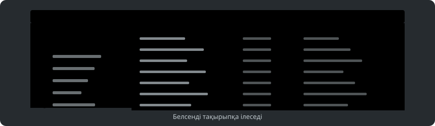

<p align="center"></p>

<div align="center">

<details><summary><b>Тіл: Қазақша</b> (26)</summary>

<table><tr><td><a href="../../README.md"> English</a></td><td><a href="../../GiDo/RU-ru/README.md"> Русский</a></td><td><a href="../../GiDo/ZH-cn/README.md"> 简体中文</a></td><td><a href="../../GiDo/ES-es/README.md"> Español</a></td><td><a href="../../GiDo/HI-in/README.md"> हिन्दी</a></td></tr><tr><td><a href="../../GiDo/FR-fr/README.md"> Français</a></td><td><a href="../../GiDo/BN-bd/README.md"> বাংলা</a></td><td><a href="../../GiDo/PT-br/README.md"> Português</a></td><td><a href="../../GiDo/UR-pk/README.md"> اردو</a></td><td><a href="../../GiDo/ID-id/README.md"> Indonesia</a></td></tr><tr><td><a href="../../GiDo/DE-de/README.md"> Deutsch</a></td><td><a href="../../GiDo/JA-jp/README.md"> 日本語</a></td><td><a href="../../GiDo/TR-tr/README.md"> Türkçe</a></td><td><a href="../../GiDo/KO-kr/README.md"> 한국어</a></td><td><a href="../../GiDo/VI-vn/README.md"> Tiếng Việt</a></td></tr><tr><td><a href="../../GiDo/IT-it/README.md"> Italiano</a></td><td><a href="../../GiDo/PL-pl/README.md"> Polski</a></td><td><a href="../../GiDo/UK-ua/README.md"> Українська</a></td><td><a href="../../GiDo/TH-th/README.md"> ไทย</a></td><td><b> Қазақша</b></td></tr><tr><td><a href="../../GiDo/UZ-uz/README.md"> Oʻzbekcha</a></td><td><a href="../../GiDo/BE-by/README.md"> Беларуская</a></td><td><a href="../../GiDo/AZ-az/README.md"> Azərbaycanca</a></td><td><a href="../../GiDo/HY-am/README.md"> Հայերեն</a></td><td><a href="../../GiDo/ISV-sl/README.md"> Medžuslovjansky</a></td></tr><tr><td><a href="../../GiDo/HE-il/README.md"> עברית</a></td></tr></table>
</details>

</div>

<p align="center"><a href="https://github.com/Arkomiko/Fruity-Organizer-DataBase/releases/latest"><b>⬇ FODB.exe жүктеу</b></a> &nbsp;|&nbsp; <a href="https://arkomiko.github.io/Fruity-Organizer-DataBase/KK-kz/wiki/index.html"><b>Уики</b></a> &nbsp;|&nbsp; <a href="https://github.com/Arkomiko/Fruity-Organizer-DataBase/blob/main/GiDo/ROADMAP.md"><b>Roadmap</b></a></p>

<p align="center">By <a href="https://arkomiko.net"><b>Arkomiko</b></a></p>

FL Studio плагин базасына арналған портативті органайзер. Плагиндерді қалталарға өндіруші, мақсат немесе екеуі бойынша бірден реттейді, әрі FL Studio-ның өз бөлігіндей көрінеді.

<p align="center"></p>

## Мүмкіндіктер

- Өндіруші немесе мақсат бойынша сұрыптау немесе кез келген ретпен кірістіру: Өндіруші\Мақсат не Мақсат\Өндіруші
- Әр плагиннің не үшін екенін анықтайды: реверберация, эквалайзер, динамика, синтезатор және тағы 18 мақсат
- Мақсат, өндіруші, формат, разряд, күй, файл күні, өлшем және басқа сүзгілер
- Ағымдағы FL Studio тақырыбын бірден қолданады
- Автоматты бэкаптар, бір басумен болдырмау, ештеңе база қалтасынан шықпайды
- Орнатусыз 10 МБ бір файл; баптаулар оның жанында сақталады
- 26 интерфейс тілі және орналасу, перне, масштаб, қаріп, түс баптаулары
- Қосымша модтар: плагиндердің үлкен тізімі, ашық каталог, үйренетін нақты мақсаттар, алдын ала қарау ағашы және күй белгілері. Баптаулардың «Деректер» бөлімінде қосылады.

## Жылдам бастау

1. FODB.exe жүктеп, іске қосыңыз. Плагин базасы автоматты түрде табылады.
2. Қалта орналасуын таңдап, көздер мен сүзгілерді қосыңыз немесе өшіріңіз.
3. «Плагиндерді реттеу» батырмасын басып, алдын ала қарауды тексеріңіз, сосын FL Studio-да плагин шолғышын жаңартыңыз.

## Қалта орналасулары

<p align="center"></p>

Дайын орналасуды таңдаңыз немесе осы бөліктерден өз үлгіңізді жазыңыз:

```text
{vendor}  {purpose}  {format}  {bits}  {letter}  {kind}

{vendor}\{purpose}
{purpose}\{vendor}
USER\{format}\{vendor}
```

## Сүзгілер

«Сүзгілер» мәзірінде мәндерді белгілеңіз немесе іздеу өрісіне шарттарды жазыңыз:

```text
purpose:reverb,delay                 reverb OR delay
vendor:"plugin alliance" -format:vst  one vendor, without VST2
organized:no kind:synth               synths not organized yet
age:30d bits:64                       64-bit, dated in the last 30 days
```

## FL Studio тақырыптары

<p align="center"></p>

FODB белсенді тақырыпты оқиды және оны FL Studio-да өзгерткенде түстерін жаңартады. Негізгі түстер өте жақын, бірақ пиксельге дейін сәйкес емес.

## Қауіпсіздік

- Плагиндеріңіз өзгермейді. Installed қалтасында тек New тізімі өзгеруі мүмкін: реттелген плагин одан шығады, мұны өшіруге болады.
- Әр іске қосуды болдырмауға болады, алынған файлдар себетке кетеді.
- Әр өзгеріс алдында базаның ZIP бэкапы жасалады; соңғы 40-ы сақталады, санын өзгертуге болады.

## Өз ережелеріңіз

«Баптаулар» қойындысында немесе FODB.json ішінде ережелер қосып, тұрақты өрнектермен атауы не өндірушісі бойынша мақсат беріңіз:

```json
"purpose_rules": [
  { "purpose": "drums", "name": "kick|808" },
  { "purpose": "vocal", "vendor": "antares" }
]
```

## Бастапқы кодтан жинау

Windows және Python 3.13 қажет. Бағдарламаның өзі тек стандартты кітапхананы пайдаланады.

```powershell
./packaging/build.ps1
```

## Алғыс

Magabes пен авторлардың FL Studio Automatic Plugin Organizer негізінде, MIT лицензиясымен.

Image-Line компаниясына қатысы жоқ тәуелсіз жоба. FL Studio — Image-Line сауда белгісі.
