<p align="center"></p>

<div align="center">

<details><summary><b>언어: 한국어</b> (26)</summary>

<table><tr><td><a href="../../README.md"> English</a></td><td><a href="../../GiDo/RU-ru/README.md"> Русский</a></td><td><a href="../../GiDo/ZH-cn/README.md"> 简体中文</a></td><td><a href="../../GiDo/ES-es/README.md"> Español</a></td><td><a href="../../GiDo/HI-in/README.md"> हिन्दी</a></td></tr><tr><td><a href="../../GiDo/FR-fr/README.md"> Français</a></td><td><a href="../../GiDo/BN-bd/README.md"> বাংলা</a></td><td><a href="../../GiDo/PT-br/README.md"> Português</a></td><td><a href="../../GiDo/UR-pk/README.md"> اردو</a></td><td><a href="../../GiDo/ID-id/README.md"> Indonesia</a></td></tr><tr><td><a href="../../GiDo/DE-de/README.md"> Deutsch</a></td><td><a href="../../GiDo/JA-jp/README.md"> 日本語</a></td><td><a href="../../GiDo/TR-tr/README.md"> Türkçe</a></td><td><b> 한국어</b></td><td><a href="../../GiDo/VI-vn/README.md"> Tiếng Việt</a></td></tr><tr><td><a href="../../GiDo/IT-it/README.md"> Italiano</a></td><td><a href="../../GiDo/PL-pl/README.md"> Polski</a></td><td><a href="../../GiDo/UK-ua/README.md"> Українська</a></td><td><a href="../../GiDo/TH-th/README.md"> ไทย</a></td><td><a href="../../GiDo/KK-kz/README.md"> Қазақша</a></td></tr><tr><td><a href="../../GiDo/UZ-uz/README.md"> Oʻzbekcha</a></td><td><a href="../../GiDo/BE-by/README.md"> Беларуская</a></td><td><a href="../../GiDo/AZ-az/README.md"> Azərbaycanca</a></td><td><a href="../../GiDo/HY-am/README.md"> Հայերեն</a></td><td><a href="../../GiDo/ISV-sl/README.md"> Medžuslovjansky</a></td></tr><tr><td><a href="../../GiDo/HE-il/README.md"> עברית</a></td></tr></table>
</details>

</div>

<p align="center"><a href="https://github.com/Arkomiko/Fruity-Organizer-DataBase/releases/latest"><b>⬇ FODB.exe 다운로드</b></a> &nbsp;|&nbsp; <a href="https://arkomiko.github.io/Fruity-Organizer-DataBase/KO-kr/wiki/index.html"><b>위키</b></a> &nbsp;|&nbsp; <a href="https://github.com/Arkomiko/Fruity-Organizer-DataBase/blob/main/GiDo/ROADMAP.md"><b>Roadmap</b></a></p>

<p align="center">By <a href="https://arkomiko.net"><b>Arkomiko</b></a></p>

FL Studio 플러그인 데이터베이스를 위한 포터블 정리 도구입니다. 플러그인을 제조사, 용도 또는 둘 다에 따라 폴더로 정리하며 FL Studio와 잘 어울리는 모습으로 동작합니다.

<p align="center"></p>

## 기능

- 제조사별, 용도별 정렬 또는 원하는 순서로 중첩: 제조사\용도 또는 용도\제조사
- 플러그인 용도 판별: 리버브, EQ, 다이내믹, 신스 등 총 22가지
- 용도, 제조사, 형식, 비트, 상태, 파일 날짜, 크기 등으로 필터링
- 현재 FL Studio 테마를 실시간으로 따라갑니다
- 자동 백업, 클릭 한 번으로 되돌리기, 데이터베이스 폴더 밖으로 나가는 것은 없습니다
- 설치가 필요 없는 10 MB 단일 파일, 설정은 그 옆에 저장됩니다
- 26개 인터페이스 언어와 배치, 단축키, 배율, 글꼴, 색상 등의 설정
- 선택형 모드: 더 큰 플러그인 목록, 공개 카탈로그, 학습하는 세분화된 용도, 미리 보기 트리, 상태 색 띠. 설정의 데이터에서 켭니다.

## 빠른 시작

1. FODB.exe를 내려받아 실행하세요. 플러그인 데이터베이스는 자동으로 찾습니다.
2. 폴더 구성을 고르고 소스와 필터를 켜거나 끄세요.
3. “플러그인 정리”를 누르고 미리보기를 확인한 뒤 FL Studio에서 플러그인 브라우저를 새로 고치세요.

## 폴더 구성

<p align="center"></p>

프리셋을 고르거나 다음 요소로 템플릿을 직접 작성하세요:

```text
{vendor}  {purpose}  {format}  {bits}  {letter}  {kind}

{vendor}\{purpose}
{purpose}\{vendor}
USER\{format}\{vendor}
```

## 필터

필터 메뉴에서 값을 선택하거나 검색창에 조건을 입력하세요:

```text
purpose:reverb,delay                 reverb OR delay
vendor:"plugin alliance" -format:vst  one vendor, without VST2
organized:no kind:synth               synths not organized yet
age:30d bits:64                       64-bit, dated in the last 30 days
```

## FL Studio 테마

<p align="center"></p>

FODB는 활성 테마를 읽고 FL Studio에서 변경하면 색상을 업데이트합니다. 기본 색상은 매우 비슷하지만 픽셀 단위로 동일하지는 않습니다.

## 안전

- 플러그인 자체는 절대 바뀌지 않습니다. Installed 폴더에서는 New 목록만 바뀔 수 있습니다. 정리한 플러그인은 목록에서 빠지며 이 동작은 끌 수 있습니다.
- 모든 실행은 되돌릴 수 있고, 제거한 파일은 휴지통으로 이동합니다.
- 변경할 때마다 데이터베이스 ZIP 백업을 만듭니다. 최신 40개를 보관하며 개수는 바꿀 수 있습니다.

## 나만의 규칙

설정 탭이나 FODB.json에서 규칙을 추가해 정규식으로 이름이나 제조사별 용도를 지정하세요:

```json
"purpose_rules": [
  { "purpose": "drums", "name": "kick|808" },
  { "purpose": "vocal", "vendor": "antares" }
]
```

## 소스에서 빌드

Windows와 Python 3.13이 필요합니다. 프로그램은 표준 라이브러리만 사용합니다.

```powershell
./packaging/build.ps1
```

## 크레딧

Magabes와 기여자들의 FL Studio Automatic Plugin Organizer를 기반으로 하며 MIT 라이선스를 따릅니다.

독립 프로젝트이며 Image-Line과 관련이 없습니다. FL Studio는 Image-Line의 상표입니다.
