<p align="center"></p>

<p align="center">
<a href="../../README.md"></a>
<a href="../../GiDo/RU-ru/README.md"></a>
<a href="../../GiDo/ZH-cn/README.md"></a>
<a href="../../GiDo/ES-es/README.md"></a>
<a href="../../GiDo/HI-in/README.md"></a>
<a href="../../GiDo/FR-fr/README.md"></a>
<a href="../../GiDo/BN-bd/README.md"></a>
<a href="../../GiDo/PT-br/README.md"></a>
<a href="../../GiDo/UR-pk/README.md"></a>
<a href="../../GiDo/ID-id/README.md"></a>
<a href="../../GiDo/DE-de/README.md"></a>
<a href="../../GiDo/JA-jp/README.md"></a>
<a href="../../GiDo/TR-tr/README.md"></a>
<a href="../../GiDo/KO-kr/README.md"></a>
<a href="../../GiDo/VI-vn/README.md"></a>
<a href="../../GiDo/IT-it/README.md"></a>
<a href="../../GiDo/PL-pl/README.md"></a>
<a href="../../GiDo/UK-ua/README.md"></a>
<a href="../../GiDo/TH-th/README.md"></a>
</p>

<p align="center"><a href="https://github.com/Arkomiko/Fruity-Organizer-DataBase/releases/latest"><b>⬇ Pobierz FODB.exe</b></a></p>

Przenośny organizer bazy wtyczek FL Studio. Układa wtyczki w folderach według producenta, przeznaczenia lub obu naraz i wygląda jak naturalna część FL Studio.

<p align="center"></p>

## Funkcje

- Sortowanie według producenta, przeznaczenia lub zagnieżdżanie w dowolnej kolejności: Producent\Przeznaczenie albo Przeznaczenie\Producent
- Rozpoznaje przeznaczenie wtyczki: pogłos, EQ, dynamika, syntezator i 18 innych
- Filtry według przeznaczenia, producenta, formatu, bitów, stanu, daty pliku, rozmiaru i innych
- Na bieżąco podąża za aktualnym motywem FL Studio
- Automatyczne kopie zapasowe, cofanie jednym kliknięciem, nic nie opuszcza folderu bazy
- Jeden plik 9 MB bez instalacji; ustawienia leżą obok niego
- 19 języków interfejsu oraz ustawienia układu, skrótów, skali, czcionek, kolorów i nie tylko

## Szybki start

1. Pobierz FODB.exe i uruchom. Baza wtyczek zostanie znaleziona automatycznie.
2. Wybierz układ folderów oraz włącz lub wyłącz źródła i filtry.
3. Naciśnij „Organizuj wtyczki”, sprawdź podgląd i odśwież przeglądarkę wtyczek w FL Studio.

## Układy folderów

<p align="center"></p>

Wybierz gotowy układ lub napisz własny szablon z tych części:

```text
{vendor}  {purpose}  {format}  {bits}  {letter}  {kind}

{vendor}\{purpose}
{purpose}\{vendor}
USER\{format}\{vendor}
```

## Filtry

Zaznacz wartości w menu Filtry lub wpisz warunki w polu wyszukiwania:

```text
purpose:reverb,delay                 reverb OR delay
vendor:"plugin alliance" -format:vst  one vendor, without VST2
organized:no kind:synth               synths not organized yet
age:30d bits:64                       64-bit, dated in the last 30 days
```

## Motywy FL Studio

<p align="center"></p>

FODB odczytuje aktywny motyw i aktualizuje kolory, gdy zmienisz go w FL Studio. Kolory bazowe są bardzo zbliżone, ale nie identyczne co do piksela.

## Bezpieczeństwo

- Twoje wtyczki nigdy nie są zmieniane. W folderze Installed może zmienić się tylko lista New: uporządkowana wtyczka ją opuszcza, a można to wyłączyć.
- Każde uruchomienie można cofnąć, a usunięte pliki trafiają do Kosza.
- Przed każdą zmianą powstaje kopia ZIP bazy; przechowywanych jest 40 najnowszych, a liczbę można zmienić.

## Własne reguły

Dodawaj reguły na karcie Ustawienia lub w FODB.json, aby wyrażeniami regularnymi ustalać przeznaczenie według nazwy lub producenta:

```json
"purpose_rules": [
  { "purpose": "drums", "name": "kick|808" },
  { "purpose": "vocal", "vendor": "antares" }
]
```

## Budowanie ze źródeł

Wymaga Windows i Pythona 3.13. Program korzysta tylko z biblioteki standardowej.

```powershell
./build.ps1
```

## Podziękowania

Oparte na FL Studio Automatic Plugin Organizer autorstwa Magabes i współtwórców, na licencji MIT.

Niezależny projekt, niezwiązany z Image-Line. FL Studio jest znakiem towarowym Image-Line.
