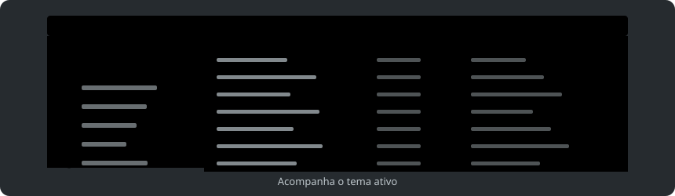

<p align="center"></p>

<p align="center">
<a href="../../README.md"></a>
<a href="../../GiDo/RU-ru/README.md"></a>
<a href="../../GiDo/ZH-cn/README.md"></a>
<a href="../../GiDo/ES-es/README.md"></a>
<a href="../../GiDo/HI-in/README.md"></a>
<a href="../../GiDo/AR-sa/README.md"></a>
<a href="../../GiDo/FR-fr/README.md"></a>
<a href="../../GiDo/BN-bd/README.md"></a>
<a href="../../GiDo/PT-br/README.md"></a>
<a href="../../GiDo/UR-pk/README.md"></a>
<a href="../../GiDo/ID-id/README.md"></a>
<a href="../../GiDo/DE-de/README.md"></a>
<a href="../../GiDo/JA-jp/README.md"></a>
<a href="../../GiDo/TR-tr/README.md"></a>
<a href="../../GiDo/KO-kr/README.md"></a>
<a href="../../GiDo/VI-vn/README.md"></a>
<a href="../../GiDo/IT-it/README.md"></a>
<a href="../../GiDo/PL-pl/README.md"></a>
<a href="../../GiDo/UK-ua/README.md"></a>
<a href="../../GiDo/TH-th/README.md"></a>
</p>

<p align="center"><a href="https://github.com/Arkomiko/Fruity-Organizer-DataBase/releases/latest"><b>⬇ Baixar FODB.exe</b></a></p>

Um organizador portátil para o banco de plugins do FL Studio. Coloca os plugins em pastas por fabricante, por finalidade ou ambos, com um visual que combina com o FL Studio.

<p align="center"></p>

## Recursos

- Organize por fabricante, por finalidade ou aninhe em qualquer ordem: Fabricante\Finalidade ou Finalidade\Fabricante
- Identifica para que serve cada plugin: reverb, EQ, dinâmica, sintetizador e mais 18 finalidades
- Filtros por finalidade, fabricante, formato, bits, status, data do arquivo, tamanho e mais
- Acompanha o tema atual do FL Studio em tempo real
- Backups automáticos, desfazer com um clique, nada sai da pasta do banco
- Um único arquivo de 9 MB sem instalação; as configurações ficam ao lado dele
- 20 idiomas de interface e ajustes de organização, atalhos, escala, fontes, cores e mais

## Início rápido

1. Baixe o FODB.exe e execute. O banco de plugins é encontrado automaticamente.
2. Escolha um layout de pastas e ative as fontes e os filtros desejados.
3. Clique em “Organizar plugins”, confira a prévia e atualize o navegador de plugins no FL Studio.

## Layouts de pastas

<p align="center"></p>

Escolha uma predefinição ou escreva seu modelo com estas partes:

```text
{vendor}  {purpose}  {format}  {bits}  {letter}  {kind}

{vendor}\{purpose}
{purpose}\{vendor}
USER\{format}\{vendor}
```

## Filtros

Marque valores no menu Filtros ou digite condições na caixa de busca:

```text
purpose:reverb,delay                 reverb OR delay
vendor:"plugin alliance" -format:vst  one vendor, without VST2
organized:no kind:synth               synths not organized yet
age:30d bits:64                       64-bit, dated in the last 30 days
```

## Temas do FL Studio

<p align="center"></p>

O FODB lê o tema ativo e atualiza as cores quando você o troca no FL Studio. As cores base são muito próximas, mas não idênticas pixel a pixel.

## Segurança

- Seus plugins nunca são alterados. Na pasta Installed só a lista New pode mudar: o plugin organizado sai dela, e isso pode ser desativado.
- Cada execução pode ser desfeita, e os arquivos removidos vão para a Lixeira.
- Antes de cada alteração é criado um backup ZIP do banco; os 40 mais recentes são mantidos e o número é ajustável.

## Suas próprias regras

Adicione regras na aba Configurações ou no FODB.json para definir o uso por nome ou fabricante com expressões regulares:

```json
"purpose_rules": [
  { "purpose": "drums", "name": "kick|808" },
  { "purpose": "vocal", "vendor": "antares" }
]
```

## Compilar do código-fonte

Requer Windows e Python 3.13. O programa usa apenas a biblioteca padrão.

```powershell
./build.ps1
```

## Créditos

Baseado no FL Studio Automatic Plugin Organizer de Magabes e colaboradores, sob licença MIT.

Projeto independente, sem vínculo com a Image-Line. FL Studio é uma marca da Image-Line.
