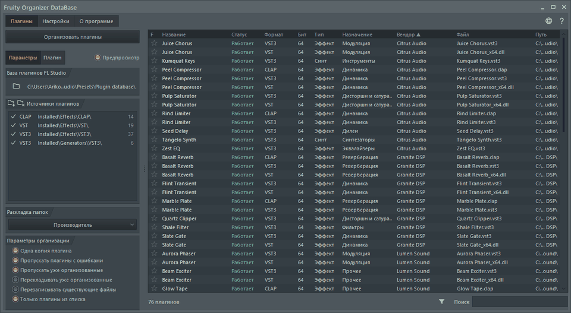

<p align="center"></p>

<p align="center">
<a href="../../README.md"></a>
<a href="../../GiDo/RU-ru/README.md"></a>
<a href="../../GiDo/ZH-cn/README.md"></a>
<a href="../../GiDo/ES-es/README.md"></a>
<a href="../../GiDo/HI-in/README.md"></a>
<a href="../../GiDo/FR-fr/README.md"></a>
<a href="../../GiDo/BN-bd/README.md"></a>
<a href="../../GiDo/PT-br/README.md"></a>
<a href="../../GiDo/UR-pk/README.md"></a>
<a href="../../GiDo/ID-id/README.md"></a>
<a href="../../GiDo/DE-de/README.md"></a>
<a href="../../GiDo/JA-jp/README.md"></a>
<a href="../../GiDo/TR-tr/README.md"></a>
<a href="../../GiDo/KO-kr/README.md"></a>
<a href="../../GiDo/VI-vn/README.md"></a>
<a href="../../GiDo/IT-it/README.md"></a>
<a href="../../GiDo/PL-pl/README.md"></a>
<a href="../../GiDo/UK-ua/README.md"></a>
<a href="../../GiDo/TH-th/README.md"></a>
<a href="../../GiDo/KK-kz/README.md"></a>
<a href="../../GiDo/UZ-uz/README.md"></a>
<a href="../../GiDo/BE-by/README.md"></a>
<a href="../../GiDo/AZ-az/README.md"></a>
<a href="../../GiDo/HY-am/README.md"></a>
<a href="../../GiDo/ISV-sl/README.md"></a>
<a href="../../GiDo/HE-il/README.md"></a>
</p>

<p align="center"><a href="https://github.com/Arkomiko/Fruity-Organizer-DataBase/releases/latest"><b>⬇ Скачать FODB.exe</b></a> &nbsp;|&nbsp; <a href="https://arkomiko.github.io/Fruity-Organizer-DataBase/RU-ru/wiki/index.html"><b>Вики</b></a></p>

Портативный органайзер базы плагинов FL Studio. Раскладывает плагины по папкам: по производителю, по назначению или сразу по обоим, а выглядит как родная часть FL Studio.

<p align="center"></p>

## Возможности

- Сортировка по производителю, по назначению или с вложенностью в любом порядке: Производитель\Назначение или Назначение\Производитель
- Определяет, для чего нужен плагин: реверберация, эквалайзер, динамика, синтезатор и ещё 18 назначений
- Фильтры по назначению, производителю, формату, разрядности, статусу, дате файла, размеру и другим признакам
- Подхватывает текущую тему FL Studio на лету
- Автоматические бэкапы, отмена в один клик, ничего не выходит за пределы папки базы
- Один файл на 10 МБ без установки; настройки хранятся рядом с ним
- 26 языков интерфейса и настройки раскладок, клавиш, масштаба, шрифтов, цветов и не только

## Быстрый старт

1. Скачайте FODB.exe и запустите. База плагинов находится автоматически.
2. Выберите раскладку папок и включите нужные источники и фильтры.
3. Нажмите «Организовать плагины», проверьте предпросмотр и обновите браузер плагинов в FL Studio.

## Раскладки папок

<p align="center"></p>

Выберите готовую раскладку или напишите свой шаблон из этих частей:

```text
{vendor}  {purpose}  {format}  {bits}  {letter}  {kind}

{vendor}\{purpose}
{purpose}\{vendor}
USER\{format}\{vendor}
```

## Фильтры

Отмечайте значения в меню «Фильтры» или вводите условия в поле поиска:

```text
purpose:reverb,delay                 reverb OR delay
vendor:"plugin alliance" -format:vst  one vendor, without VST2
organized:no kind:synth               synths not organized yet
age:30d bits:64                       64-bit, dated in the last 30 days
```

## Темы FL Studio

<p align="center"></p>

FODB читает активную тему и перестраивает цвета, когда вы меняете её в FL Studio. Базовые цвета очень близки к оригиналу, но не совпадают до пикселя.

## Безопасность

- Ваши плагины не меняются. В папке Installed может измениться только список New: разложенный плагин уходит из него, и это можно выключить.
- Любой запуск можно отменить, а удаляемые файлы уходят в корзину.
- Перед каждым изменением создаётся ZIP-бэкап базы; хранятся 40 последних, число можно изменить.

## Свои правила

Добавляйте правила на вкладке «Настройки» или в FODB.json, чтобы задавать назначение по имени или производителю с помощью регулярных выражений:

```json
"purpose_rules": [
  { "purpose": "drums", "name": "kick|808" },
  { "purpose": "vocal", "vendor": "antares" }
]
```

## Сборка из исходников

Нужны Windows и Python 3.13. Сама программа использует только стандартную библиотеку.

```powershell
./packaging/build.ps1
```

## Благодарности

Основано на FL Studio Automatic Plugin Organizer от Magabes и соавторов, лицензия MIT.

Независимый проект, не связан с Image-Line. FL Studio является товарным знаком Image-Line.
