<p align="center"></p>

<div align="center">

<details><summary><b>ภาษา: ไทย</b> (26)</summary>

<table><tr><td><a href="../../README.md"> English</a></td><td><a href="../../GiDo/RU-ru/README.md"> Русский</a></td><td><a href="../../GiDo/ZH-cn/README.md"> 简体中文</a></td><td><a href="../../GiDo/ES-es/README.md"> Español</a></td><td><a href="../../GiDo/HI-in/README.md"> हिन्दी</a></td></tr><tr><td><a href="../../GiDo/FR-fr/README.md"> Français</a></td><td><a href="../../GiDo/BN-bd/README.md"> বাংলা</a></td><td><a href="../../GiDo/PT-br/README.md"> Português</a></td><td><a href="../../GiDo/UR-pk/README.md"> اردو</a></td><td><a href="../../GiDo/ID-id/README.md"> Indonesia</a></td></tr><tr><td><a href="../../GiDo/DE-de/README.md"> Deutsch</a></td><td><a href="../../GiDo/JA-jp/README.md"> 日本語</a></td><td><a href="../../GiDo/TR-tr/README.md"> Türkçe</a></td><td><a href="../../GiDo/KO-kr/README.md"> 한국어</a></td><td><a href="../../GiDo/VI-vn/README.md"> Tiếng Việt</a></td></tr><tr><td><a href="../../GiDo/IT-it/README.md"> Italiano</a></td><td><a href="../../GiDo/PL-pl/README.md"> Polski</a></td><td><a href="../../GiDo/UK-ua/README.md"> Українська</a></td><td><b> ไทย</b></td><td><a href="../../GiDo/KK-kz/README.md"> Қазақша</a></td></tr><tr><td><a href="../../GiDo/UZ-uz/README.md"> Oʻzbekcha</a></td><td><a href="../../GiDo/BE-by/README.md"> Беларуская</a></td><td><a href="../../GiDo/AZ-az/README.md"> Azərbaycanca</a></td><td><a href="../../GiDo/HY-am/README.md"> Հայերեն</a></td><td><a href="../../GiDo/ISV-sl/README.md"> Medžuslovjansky</a></td></tr><tr><td><a href="../../GiDo/HE-il/README.md"> עברית</a></td></tr></table>
</details>

</div>

<p align="center"><a href="https://github.com/Arkomiko/Fruity-Organizer-DataBase/releases/latest"><b>⬇ ดาวน์โหลด FODB.exe</b></a> &nbsp;|&nbsp; <a href="https://arkomiko.github.io/Fruity-Organizer-DataBase/TH-th/wiki/index.html"><b>วิกิ</b></a> &nbsp;|&nbsp; <a href="https://github.com/Arkomiko/Fruity-Organizer-DataBase/blob/main/GiDo/ROADMAP.md"><b>Roadmap</b></a></p>

<p align="center">By <a href="https://arkomiko.net"><b>Arkomiko</b></a></p>

เครื่องมือจัดระเบียบแบบพกพาสำหรับฐานข้อมูลปลั๊กอินของ FL Studio จัดปลั๊กอินลงโฟลเดอร์ตามผู้ผลิต ตามการใช้งาน หรือทั้งสองอย่าง พร้อมหน้าตาที่เข้ากับ FL Studio

<p align="center"></p>

## คุณสมบัติ

- จัดเรียงตามผู้ผลิต ตามการใช้งาน หรือซ้อนกันในลำดับใดก็ได้: ผู้ผลิต\การใช้งาน หรือ การใช้งาน\ผู้ผลิต
- ระบุว่าปลั๊กอินใช้ทำอะไร: รีเวิร์บ, EQ, ไดนามิก, ซินธ์ และอีก 18 ประเภท
- ตัวกรองตามการใช้งาน ผู้ผลิต รูปแบบ บิต สถานะ วันที่ไฟล์ ขนาด และอื่น ๆ
- ตามธีม FL Studio ปัจจุบันแบบเรียลไทม์
- สำรองข้อมูลอัตโนมัติ เลิกทำได้ในคลิกเดียว ไม่มีสิ่งใดออกนอกโฟลเดอร์ฐานข้อมูล
- ไฟล์เดียวขนาด 10 MB ไม่ต้องติดตั้ง การตั้งค่าอยู่ข้างไฟล์
- 26 ภาษาอินเทอร์เฟซ พร้อมการตั้งค่าเลย์เอาต์ ปุ่มลัด ขนาด แบบอักษร สี และอื่น ๆ
- ม็อดเสริม: รายการปลั๊กอินที่ใหญ่ขึ้น แคตตาล็อกเปิด การใช้งานละเอียดที่เรียนรู้จากคุณ ต้นไม้แสดงตัวอย่าง และแถบสถานะ เปิดได้ที่การตั้งค่า หมวดข้อมูล

## เริ่มต้นอย่างรวดเร็ว

1. ดาวน์โหลด FODB.exe แล้วเปิดใช้งาน ระบบจะค้นหาฐานข้อมูลปลั๊กอินให้อัตโนมัติ
2. เลือกโครงสร้างโฟลเดอร์ แล้วเปิดหรือปิดแหล่งที่มาและตัวกรอง
3. กด “จัดระเบียบปลั๊กอิน” ตรวจดูตัวอย่าง แล้วรีเฟรชเบราว์เซอร์ปลั๊กอินใน FL Studio

## โครงสร้างโฟลเดอร์

<p align="center"></p>

เลือกค่าสำเร็จรูปหรือเขียนเทมเพลตเองจากส่วนต่อไปนี้:

```text
{vendor}  {purpose}  {format}  {bits}  {letter}  {kind}

{vendor}\{purpose}
{purpose}\{vendor}
USER\{format}\{vendor}
```

## ตัวกรอง

เลือกค่าในเมนูตัวกรอง หรือพิมพ์เงื่อนไขในช่องค้นหา:

```text
purpose:reverb,delay                 reverb OR delay
vendor:"plugin alliance" -format:vst  one vendor, without VST2
organized:no kind:synth               synths not organized yet
age:30d bits:64                       64-bit, dated in the last 30 days
```

## ธีม FL Studio

<p align="center"></p>

FODB อ่านธีมที่ใช้งานอยู่และอัปเดตสีเมื่อคุณเปลี่ยนใน FL Studio สีพื้นฐานใกล้เคียงมาก แต่ไม่ตรงกันทุกพิกเซล

## ความปลอดภัย

- ปลั๊กอินของคุณจะไม่ถูกเปลี่ยนแปลง ในโฟลเดอร์ Installed มีเพียงรายการ New ที่อาจเปลี่ยน: ปลั๊กอินที่จัดแล้วจะออกจากรายการ และปิดการทำงานนี้ได้
- ทุกการทำงานเลิกทำได้ และไฟล์ที่ลบจะไปอยู่ในถังรีไซเคิล
- ก่อนทุกการเปลี่ยนแปลงจะสร้างไฟล์สำรอง ZIP ของฐานข้อมูล เก็บ 40 ไฟล์ล่าสุดและปรับจำนวนได้

## กฎของคุณเอง

เพิ่มกฎในแท็บการตั้งค่าหรือใน FODB.json เพื่อกำหนดการใช้งานตามชื่อหรือผู้ผลิตด้วยนิพจน์ปกติ:

```json
"purpose_rules": [
  { "purpose": "drums", "name": "kick|808" },
  { "purpose": "vocal", "vendor": "antares" }
]
```

## สร้างจากซอร์สโค้ด

ต้องใช้ Windows และ Python 3.13 ตัวโปรแกรมใช้เฉพาะไลบรารีมาตรฐาน

```powershell
./packaging/build.ps1
```

## เครดิต

พัฒนาต่อจาก FL Studio Automatic Plugin Organizer โดย Magabes และผู้ร่วมพัฒนา ภายใต้สัญญาอนุญาต MIT

เป็นโครงการอิสระ ไม่มีส่วนเกี่ยวข้องกับ Image-Line โดย FL Studio เป็นเครื่องหมายการค้าของ Image-Line
