<p align="center"></p>

<p align="center">
<a href="../../README.md"></a>
<a href="../../GiDo/RU-ru/README.md"></a>
<a href="../../GiDo/ZH-cn/README.md"></a>
<a href="../../GiDo/ES-es/README.md"></a>
<a href="../../GiDo/HI-in/README.md"></a>
<a href="../../GiDo/FR-fr/README.md"></a>
<a href="../../GiDo/BN-bd/README.md"></a>
<a href="../../GiDo/PT-br/README.md"></a>
<a href="../../GiDo/UR-pk/README.md"></a>
<a href="../../GiDo/ID-id/README.md"></a>
<a href="../../GiDo/DE-de/README.md"></a>
<a href="../../GiDo/JA-jp/README.md"></a>
<a href="../../GiDo/TR-tr/README.md"></a>
<a href="../../GiDo/KO-kr/README.md"></a>
<a href="../../GiDo/VI-vn/README.md"></a>
<a href="../../GiDo/IT-it/README.md"></a>
<a href="../../GiDo/PL-pl/README.md"></a>
<a href="../../GiDo/UK-ua/README.md"></a>
<a href="../../GiDo/TH-th/README.md"></a>
<a href="../../GiDo/KK-kz/README.md"></a>
<a href="../../GiDo/UZ-uz/README.md"></a>
<a href="../../GiDo/BE-by/README.md"></a>
<a href="../../GiDo/AZ-az/README.md"></a>
<a href="../../GiDo/HY-am/README.md"></a>
<a href="../../GiDo/ISV-sl/README.md"></a>
<a href="../../GiDo/HE-il/README.md"></a>
</p>

<p align="center"><a href="https://github.com/Arkomiko/Fruity-Organizer-DataBase/releases/latest"><b>⬇ FODB.exe indir</b></a> &nbsp;|&nbsp; <a href="https://arkomiko.github.io/Fruity-Organizer-DataBase/TR-tr/wiki/index.html"><b>Wiki</b></a> &nbsp;|&nbsp; <a href="https://github.com/Arkomiko/Fruity-Organizer-DataBase/blob/main/GiDo/ROADMAP.md"><b>Roadmap</b></a></p>

<p align="center">By <a href="https://arkomiko.net"><b>Arkomiko</b></a></p>

FL Studio eklenti veritabanı için taşınabilir bir düzenleyici. Eklentileri üreticiye, kullanım amacına veya her ikisine göre klasörlere yerleştirir ve FL Studio ile uyumlu görünür.

<p align="center"></p>

## Özellikler

- Üreticiye, amaca göre sıralayın veya istediğiniz sırada iç içe yerleştirin: Üretici\Amaç ya da Amaç\Üretici
- Her eklentinin ne işe yaradığını bulur: reverb, EQ, dinamik, synth ve 18 amaç daha
- Amaç, üretici, biçim, bit, durum, dosya tarihi, boyut ve daha fazlası için filtreler
- Geçerli FL Studio temasını anında izler
- Otomatik yedekler, tek tıkla geri alma, hiçbir şey veritabanı klasörünün dışına çıkmaz
- Kurulum gerektirmeyen tek bir 10 MB dosya; ayarlar yanında durur
- 26 arayüz dili ve yerleşim, kısayol, ölçek, yazı tipi, renk gibi ayarlar
- İsteğe bağlı modlar: daha geniş eklenti listesi, açık katalog, sizden öğrenen ayrıntılı kullanımlar, önizleme ağacı ve durum şeritleri. Ayarlar, Veri bölümünden açılır.

## Hızlı başlangıç

1. FODB.exe dosyasını indirip çalıştırın. Eklenti veritabanı otomatik bulunur.
2. Bir klasör düzeni seçin, kaynakları ve filtreleri açıp kapatın.
3. “Eklentileri düzenle” düğmesine basın, önizlemeyi kontrol edin ve FL Studio'da eklenti tarayıcısını yenileyin.

## Klasör düzenleri

<p align="center"></p>

Hazır bir düzen seçin veya şu parçalarla kendi şablonunuzu yazın:

```text
{vendor}  {purpose}  {format}  {bits}  {letter}  {kind}

{vendor}\{purpose}
{purpose}\{vendor}
USER\{format}\{vendor}
```

## Filtreler

Filtreler menüsünde değerleri işaretleyin veya arama kutusuna koşul yazın:

```text
purpose:reverb,delay                 reverb OR delay
vendor:"plugin alliance" -format:vst  one vendor, without VST2
organized:no kind:synth               synths not organized yet
age:30d bits:64                       64-bit, dated in the last 30 days
```

## FL Studio temaları

<p align="center"></p>

FODB etkin temayı okur ve FL Studio'da değiştirdiğinizde renklerini günceller. Temel renkler çok yakındır, ancak piksel piksel aynı değildir.

## Güvenlik

- Eklentileriniz asla değiştirilmez. Installed klasöründe yalnızca New listesi değişebilir: düzenlenen eklenti listeden çıkar ve bu kapatılabilir.
- Her işlem geri alınabilir, kaldırılan dosyalar Geri Dönüşüm Kutusu'na gider.
- Her değişiklikten önce veritabanının ZIP yedeği alınır; en yeni 40 yedek saklanır ve sayı ayarlanabilir.

## Kendi kurallarınız

Ayarlar sekmesinden veya FODB.json içinden kural ekleyerek düzenli ifadelerle ada ya da üreticiye göre kullanım belirleyin:

```json
"purpose_rules": [
  { "purpose": "drums", "name": "kick|808" },
  { "purpose": "vocal", "vendor": "antares" }
]
```

## Kaynaktan derleme

Windows ve Python 3.13 gerekir. Program yalnızca standart kitaplığı kullanır.

```powershell
./packaging/build.ps1
```

## Teşekkürler

Magabes ve katkıda bulunanların FL Studio Automatic Plugin Organizer projesine dayanır, MIT Lisansı ile.

Bağımsız bir projedir, Image-Line ile bağlantılı değildir. FL Studio, Image-Line'ın ticari markasıdır.
