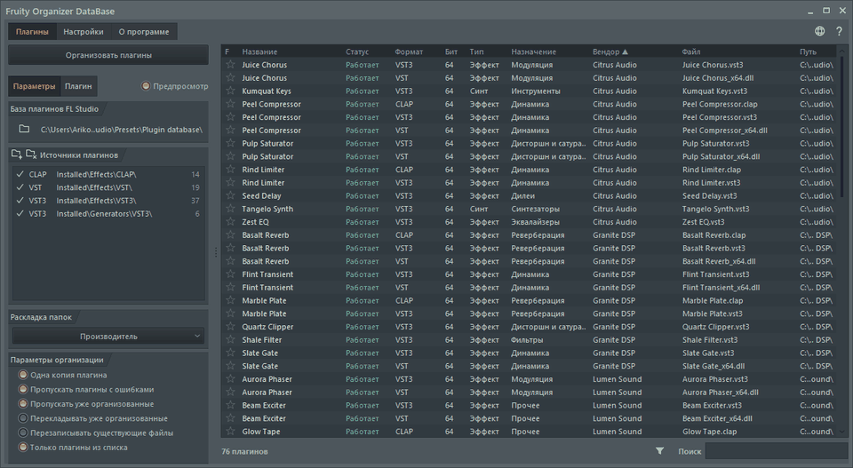

<p align="center"></p>

<p align="center">
<a href="../../README.md"></a>
<a href="../../GiDo/RU-ru/README.md"></a>
<a href="../../GiDo/ZH-cn/README.md"></a>
<a href="../../GiDo/ES-es/README.md"></a>
<a href="../../GiDo/HI-in/README.md"></a>
<a href="../../GiDo/FR-fr/README.md"></a>
<a href="../../GiDo/BN-bd/README.md"></a>
<a href="../../GiDo/PT-br/README.md"></a>
<a href="../../GiDo/UR-pk/README.md"></a>
<a href="../../GiDo/ID-id/README.md"></a>
<a href="../../GiDo/DE-de/README.md"></a>
<a href="../../GiDo/JA-jp/README.md"></a>
<a href="../../GiDo/TR-tr/README.md"></a>
<a href="../../GiDo/KO-kr/README.md"></a>
<a href="../../GiDo/VI-vn/README.md"></a>
<a href="../../GiDo/IT-it/README.md"></a>
<a href="../../GiDo/PL-pl/README.md"></a>
<a href="../../GiDo/UK-ua/README.md"></a>
<a href="../../GiDo/TH-th/README.md"></a>
<a href="../../GiDo/KK-kz/README.md"></a>
<a href="../../GiDo/UZ-uz/README.md"></a>
<a href="../../GiDo/BE-by/README.md"></a>
<a href="../../GiDo/AZ-az/README.md"></a>
<a href="../../GiDo/HY-am/README.md"></a>
<a href="../../GiDo/ISV-sl/README.md"></a>
<a href="../../GiDo/HE-il/README.md"></a>
</p>

<p align="center"><a href="https://github.com/Arkomiko/Fruity-Organizer-DataBase/releases/latest"><b>⬇ Завантажити FODB.exe</b></a> &nbsp;|&nbsp; <a href="https://arkomiko.github.io/Fruity-Organizer-DataBase/UK-ua/wiki/index.html"><b>Вікі</b></a></p>

Портативний органайзер бази плагінів FL Studio. Розкладає плагіни по папках за виробником, призначенням або одразу за обома й виглядає як природна частина FL Studio.

<p align="center"></p>

## Можливості

- Сортування за виробником, за призначенням або з вкладеністю в будь-якому порядку: Виробник\Призначення чи Призначення\Виробник
- Визначає, для чого плагін: реверберація, еквалайзер, динаміка, синтезатор та ще 18 призначень
- Фільтри за призначенням, виробником, форматом, розрядністю, статусом, датою файлу, розміром тощо
- Миттєво підхоплює поточну тему FL Studio
- Автоматичні резервні копії, скасування одним кліком, нічого не виходить за межі папки бази
- Один файл на 10 МБ без встановлення; налаштування зберігаються поруч
- 26 мов інтерфейсу та налаштування розкладок, клавіш, масштабу, шрифтів, кольорів тощо

## Швидкий старт

1. Завантажте FODB.exe і запустіть. Базу плагінів буде знайдено автоматично.
2. Виберіть розкладку папок та ввімкніть потрібні джерела і фільтри.
3. Натисніть «Організувати плагіни», перевірте попередній перегляд та оновіть браузер плагінів у FL Studio.

## Розкладки папок

<p align="center"></p>

Виберіть готову розкладку або напишіть власний шаблон із цих частин:

```text
{vendor}  {purpose}  {format}  {bits}  {letter}  {kind}

{vendor}\{purpose}
{purpose}\{vendor}
USER\{format}\{vendor}
```

## Фільтри

Позначайте значення в меню «Фільтри» або вводьте умови в полі пошуку:

```text
purpose:reverb,delay                 reverb OR delay
vendor:"plugin alliance" -format:vst  one vendor, without VST2
organized:no kind:synth               synths not organized yet
age:30d bits:64                       64-bit, dated in the last 30 days
```

## Теми FL Studio

<p align="center"></p>

FODB читає активну тему й оновлює кольори, коли ви змінюєте її у FL Studio. Базові кольори дуже близькі, але не збігаються до пікселя.

## Безпека

- Ваші плагіни не змінюються. У папці Installed може змінитися лише список New: розкладений плагін виходить із нього, і це можна вимкнути.
- Кожен запуск можна скасувати, а вилучені файли потрапляють до кошика.
- Перед кожною зміною створюється ZIP-бекап бази; зберігаються 40 останніх, кількість можна змінити.

## Власні правила

Додавайте правила на вкладці «Налаштування» або у FODB.json, щоб задавати призначення за назвою чи виробником регулярними виразами:

```json
"purpose_rules": [
  { "purpose": "drums", "name": "kick|808" },
  { "purpose": "vocal", "vendor": "antares" }
]
```

## Збирання з вихідного коду

Потрібні Windows і Python 3.13. Сама програма використовує лише стандартну бібліотеку.

```powershell
./packaging/build.ps1
```

## Подяки

Засновано на FL Studio Automatic Plugin Organizer від Magabes та співавторів, ліцензія MIT.

Незалежний проєкт, не пов'язаний з Image-Line. FL Studio є торговельною маркою Image-Line.
