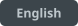
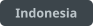
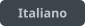
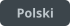
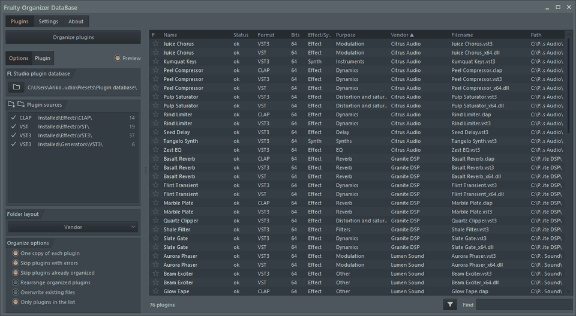

<div dir="rtl">

<p align="center"></p>

<p align="center">
<a href="../../README.md"></a>
<a href="../../GiDo/RU-ru/README.md"></a>
<a href="../../GiDo/ZH-cn/README.md"></a>
<a href="../../GiDo/ES-es/README.md"></a>
<a href="../../GiDo/HI-in/README.md"></a>
<a href="../../GiDo/FR-fr/README.md"></a>
<a href="../../GiDo/BN-bd/README.md"></a>
<a href="../../GiDo/PT-br/README.md"></a>
<a href="../../GiDo/UR-pk/README.md"></a>
<a href="../../GiDo/ID-id/README.md"></a>
<a href="../../GiDo/DE-de/README.md"></a>
<a href="../../GiDo/JA-jp/README.md"></a>
<a href="../../GiDo/TR-tr/README.md"></a>
<a href="../../GiDo/KO-kr/README.md"></a>
<a href="../../GiDo/VI-vn/README.md"></a>
<a href="../../GiDo/IT-it/README.md"></a>
<a href="../../GiDo/PL-pl/README.md"></a>
<a href="../../GiDo/UK-ua/README.md"></a>
<a href="../../GiDo/TH-th/README.md"></a>
<a href="../../GiDo/KK-kz/README.md"></a>
<a href="../../GiDo/UZ-uz/README.md"></a>
<a href="../../GiDo/BE-by/README.md"></a>
<a href="../../GiDo/AZ-az/README.md"></a>
<a href="../../GiDo/HY-am/README.md"></a>
<a href="../../GiDo/ISV-sl/README.md"></a>
<a href="../../GiDo/HE-il/README.md"></a>
</p>

<p align="center"><a href="https://github.com/Arkomiko/Fruity-Organizer-DataBase/releases/latest"><b>⬇ FODB.exe ڈاؤن لوڈ کریں</b></a> &nbsp;|&nbsp; <a href="https://arkomiko.github.io/Fruity-Organizer-DataBase/UR-pk/wiki/index.html"><b>وکی</b></a></p>

FL Studio پلگ اِن ڈیٹا بیس کے لیے ایک پورٹیبل آرگنائزر۔ یہ پلگ اِنز کو بنانے والے، استعمال یا دونوں کے مطابق فولڈرز میں رکھتا ہے اور FL Studio کے ساتھ ہم آہنگ دکھائی دیتا ہے۔

<p align="center"></p>

## خصوصیات

- بنانے والے یا استعمال کے مطابق ترتیب دیں، یا کسی بھی ترتیب میں نیسٹ کریں: بنانے والا\استعمال یا استعمال\بنانے والا
- پہچانتا ہے کہ پلگ اِن کس کام کا ہے: ریورب، EQ، ڈائنامکس، سنتھ اور 18 دیگر استعمال
- استعمال، بنانے والے، فارمیٹ، بٹس، حالت، فائل کی تاریخ، سائز وغیرہ کے فلٹر
- FL Studio کی موجودہ تھیم کی فوری پیروی کرتا ہے
- خودکار بیک اپ، ایک کلک میں واپسی، کچھ بھی ڈیٹا بیس فولڈر سے باہر نہیں جاتا
- 10 MB کی ایک فائل، انسٹالیشن کی ضرورت نہیں؛ سیٹنگز اسی کے ساتھ رہتی ہیں
- انٹرفیس کی 26 زبانیں اور لے آؤٹ، شارٹ کٹ، پیمانے، فونٹ، رنگوں وغیرہ کی ترتیبات

## فوری آغاز

1. FODB.exe ڈاؤن لوڈ کرکے چلائیں۔ پلگ اِن ڈیٹا بیس خود بخود مل جاتا ہے۔
2. فولڈر لے آؤٹ منتخب کریں اور ذرائع اور فلٹر آن یا آف کریں۔
3. «پلگ اِنز منظم کریں» دبائیں، پیش منظر دیکھیں، پھر FL Studio میں پلگ اِن براؤزر ریفریش کریں۔

## فولڈر لے آؤٹ

<p align="center"></p>

کوئی پری سیٹ منتخب کریں یا ان حصوں سے اپنا ٹیمپلیٹ لکھیں:

```text
{vendor}  {purpose}  {format}  {bits}  {letter}  {kind}

{vendor}\{purpose}
{purpose}\{vendor}
USER\{format}\{vendor}
```

## فلٹر

فلٹر مینو میں قدریں منتخب کریں یا تلاش کے خانے میں شرائط لکھیں:

```text
purpose:reverb,delay                 reverb OR delay
vendor:"plugin alliance" -format:vst  one vendor, without VST2
organized:no kind:synth               synths not organized yet
age:30d bits:64                       64-bit, dated in the last 30 days
```

## FL Studio تھیمز

<p align="center"></p>

FODB فعال تھیم پڑھتا ہے اور FL Studio میں بدلنے پر اپنے رنگ تازہ کرتا ہے۔ بنیادی رنگ بہت قریب ہیں لیکن پکسل کی حد تک یکساں نہیں۔

## حفاظت

- آپ کے پلگ اِن کبھی نہیں بدلتے۔ Installed فولڈر میں صرف New فہرست بدل سکتی ہے: منظم پلگ اِن اس سے نکل جاتا ہے، اور اسے بند کیا جا سکتا ہے۔
- ہر عمل واپس لیا جا سکتا ہے، اور ہٹائی گئی فائلیں ری سائیکل بن میں جاتی ہیں۔
- ہر تبدیلی سے پہلے ڈیٹا بیس کا ZIP بیک اپ بنتا ہے؛ تازہ ترین 40 رکھے جاتے ہیں اور تعداد بدلی جا سکتی ہے۔

## اپنے اصول

ترتیبات ٹیب یا FODB.json میں اصول شامل کریں اور ریگولر ایکسپریشن سے نام یا بنانے والے کے مطابق استعمال طے کریں:

```json
"purpose_rules": [
  { "purpose": "drums", "name": "kick|808" },
  { "purpose": "vocal", "vendor": "antares" }
]
```

## سورس سے بنائیں

Windows اور Python 3.13 درکار ہیں۔ پروگرام صرف اسٹینڈرڈ لائبریری استعمال کرتا ہے۔

```powershell
./build.ps1
```

## اظہارِ تشکر

Magabes اور معاونین کے FL Studio Automatic Plugin Organizer پر مبنی، MIT لائسنس کے تحت۔

آزاد منصوبہ، Image-Line سے وابستہ نہیں۔ FL Studio، Image-Line کا ٹریڈ مارک ہے۔

</div>
