<p align="center"></p>

<p align="center">
<a href="../../README.md"></a>
<a href="../../GiDo/RU-ru/README.md"></a>
<a href="../../GiDo/ZH-cn/README.md"></a>
<a href="../../GiDo/ES-es/README.md"></a>
<a href="../../GiDo/HI-in/README.md"></a>
<a href="../../GiDo/FR-fr/README.md"></a>
<a href="../../GiDo/BN-bd/README.md"></a>
<a href="../../GiDo/PT-br/README.md"></a>
<a href="../../GiDo/UR-pk/README.md"></a>
<a href="../../GiDo/ID-id/README.md"></a>
<a href="../../GiDo/DE-de/README.md"></a>
<a href="../../GiDo/JA-jp/README.md"></a>
<a href="../../GiDo/TR-tr/README.md"></a>
<a href="../../GiDo/KO-kr/README.md"></a>
<a href="../../GiDo/VI-vn/README.md"></a>
<a href="../../GiDo/IT-it/README.md"></a>
<a href="../../GiDo/PL-pl/README.md"></a>
<a href="../../GiDo/UK-ua/README.md"></a>
<a href="../../GiDo/TH-th/README.md"></a>
<a href="../../GiDo/KK-kz/README.md"></a>
<a href="../../GiDo/UZ-uz/README.md"></a>
<a href="../../GiDo/BE-by/README.md"></a>
<a href="../../GiDo/AZ-az/README.md"></a>
<a href="../../GiDo/HY-am/README.md"></a>
<a href="../../GiDo/ISV-sl/README.md"></a>
<a href="../../GiDo/HE-il/README.md"></a>
</p>

<p align="center"><a href="https://github.com/Arkomiko/Fruity-Organizer-DataBase/releases/latest"><b>⬇ FODB.exe yuklab olish</b></a> &nbsp;|&nbsp; <a href="https://arkomiko.github.io/Fruity-Organizer-DataBase/UZ-uz/wiki/index.html"><b>Viki</b></a></p>

FL Studio plaginlar bazasi uchun portativ organayzer. Plaginlarni papkalarga ishlab chiqaruvchi, vazifa yoki ikkalasi boʻyicha joylaydi va FL Studio'ning oʻz qismidek koʻrinadi.

<p align="center"></p>

## Imkoniyatlar

- Ishlab chiqaruvchi yoki vazifa boʻyicha saralash yoki istalgan tartibda joylash: Ishlab chiqaruvchi\Vazifa yoki Vazifa\Ishlab chiqaruvchi
- Har bir plagin nima uchunligini aniqlaydi: reverberatsiya, ekvalayzer, dinamika, sintezator va yana 18 vazifa
- Vazifa, ishlab chiqaruvchi, format, bit, holat, fayl sanasi, hajm va boshqa filtrlar
- Joriy FL Studio mavzusini darhol qoʻllaydi
- Avtomatik zaxiralar, bir bosishda bekor qilish, hech narsa baza papkasidan chiqmaydi
- Oʻrnatishsiz 10 MB bitta fayl; sozlamalar uning yonida saqlanadi
- 26 interfeys tili hamda joylashuv, tugmalar, masshtab, shrift va ranglar sozlamalari

## Tez boshlash

1. FODB.exe ni yuklab olib ishga tushiring. Plaginlar bazasi avtomatik topiladi.
2. Papka joylashuvini tanlang, manbalar va filtrlarni yoqing yoki oʻchiring.
3. «Plaginlarni tartiblash» tugmasini bosing, oldindan koʻrishni tekshiring, soʻng FL Studio'da plagin brauzerini yangilang.

## Papka joylashuvlari

<p align="center"></p>

Tayyor joylashuvni tanlang yoki shu qismlardan oʻz shabloningizni yozing:

```text
{vendor}  {purpose}  {format}  {bits}  {letter}  {kind}

{vendor}\{purpose}
{purpose}\{vendor}
USER\{format}\{vendor}
```

## Filtrlar

«Filtrlar» menyusida qiymatlarni belgilang yoki qidiruv maydoniga shartlarni yozing:

```text
purpose:reverb,delay                 reverb OR delay
vendor:"plugin alliance" -format:vst  one vendor, without VST2
organized:no kind:synth               synths not organized yet
age:30d bits:64                       64-bit, dated in the last 30 days
```

## FL Studio mavzulari

<p align="center"></p>

FODB faol mavzuni oʻqiydi va uni FL Studio'da oʻzgartirganingizda ranglarini yangilaydi. Asosiy ranglar juda yaqin, lekin pikselgacha mos emas.

## Xavfsizlik

- Plaginlaringiz oʻzgarmaydi. Installed papkasida faqat New roʻyxati oʻzgarishi mumkin: tartiblangan plagin undan chiqadi, buni oʻchirish mumkin.
- Har bir ishga tushirishni bekor qilish mumkin, olib tashlangan fayllar savatga ketadi.
- Har oʻzgarishdan oldin bazaning ZIP zaxirasi yaratiladi; soʻnggi 40 tasi saqlanadi, sonini oʻzgartirish mumkin.

## Oʻz qoidalaringiz

«Sozlamalar» varagʻida yoki FODB.json ichida qoidalar qoʻshib, muntazam ifodalar bilan nom yoki ishlab chiqaruvchi boʻyicha vazifa bering:

```json
"purpose_rules": [
  { "purpose": "drums", "name": "kick|808" },
  { "purpose": "vocal", "vendor": "antares" }
]
```

## Manba koddan yigʻish

Windows va Python 3.13 kerak. Dasturning oʻzi faqat standart kutubxonadan foydalanadi.

```powershell
./packaging/build.ps1
```

## Minnatdorchilik

Magabes va hammualliflarning FL Studio Automatic Plugin Organizer dasturi asosida, MIT litsenziyasi ostida.

Image-Line bilan bogʻliq boʻlmagan mustaqil loyiha. FL Studio Image-Line savdo belgisidir.
