<p align="center"></p>

<p align="center">
<a href="../../README.md"></a>
<a href="../../GiDo/RU-ru/README.md"></a>
<a href="../../GiDo/ZH-cn/README.md"></a>
<a href="../../GiDo/ES-es/README.md"></a>
<a href="../../GiDo/HI-in/README.md"></a>
<a href="../../GiDo/FR-fr/README.md"></a>
<a href="../../GiDo/BN-bd/README.md"></a>
<a href="../../GiDo/PT-br/README.md"></a>
<a href="../../GiDo/UR-pk/README.md"></a>
<a href="../../GiDo/ID-id/README.md"></a>
<a href="../../GiDo/DE-de/README.md"></a>
<a href="../../GiDo/JA-jp/README.md"></a>
<a href="../../GiDo/TR-tr/README.md"></a>
<a href="../../GiDo/KO-kr/README.md"></a>
<a href="../../GiDo/VI-vn/README.md"></a>
<a href="../../GiDo/IT-it/README.md"></a>
<a href="../../GiDo/PL-pl/README.md"></a>
<a href="../../GiDo/UK-ua/README.md"></a>
<a href="../../GiDo/TH-th/README.md"></a>
</p>

<p align="center"><a href="https://github.com/Arkomiko/Fruity-Organizer-DataBase/releases/latest"><b>⬇ Tải FODB.exe</b></a></p>

Công cụ sắp xếp di động cho cơ sở dữ liệu plugin của FL Studio. Sắp plugin vào thư mục theo hãng, theo công dụng hoặc cả hai, với giao diện hòa hợp cùng FL Studio.

<p align="center"></p>

## Tính năng

- Sắp theo hãng, theo công dụng hoặc lồng theo thứ tự bất kỳ: Hãng\Công dụng hoặc Công dụng\Hãng
- Xác định công dụng của từng plugin: reverb, EQ, dynamics, synth và 18 loại khác
- Lọc theo công dụng, hãng, định dạng, bit, trạng thái, ngày tệp, kích thước và hơn thế
- Theo dõi giao diện FL Studio hiện tại theo thời gian thực
- Sao lưu tự động, hoàn tác một lần nhấp, không có gì ra ngoài thư mục cơ sở dữ liệu
- Một tệp 9 MB không cần cài đặt; thiết lập nằm ngay bên cạnh
- 19 ngôn ngữ giao diện cùng cài đặt bố cục, phím tắt, tỷ lệ, phông chữ, màu sắc và hơn thế

## Bắt đầu nhanh

1. Tải FODB.exe và chạy. Cơ sở dữ liệu plugin được tìm tự động.
2. Chọn bố cục thư mục, rồi bật hoặc tắt nguồn và bộ lọc.
3. Nhấn “Sắp xếp plugin”, kiểm tra bản xem trước, rồi làm mới trình duyệt plugin trong FL Studio.

## Bố cục thư mục

<p align="center"></p>

Chọn mẫu có sẵn hoặc tự viết mẫu từ các phần sau:

```text
{vendor}  {purpose}  {format}  {bits}  {letter}  {kind}

{vendor}\{purpose}
{purpose}\{vendor}
USER\{format}\{vendor}
```

## Bộ lọc

Đánh dấu giá trị trong menu Bộ lọc hoặc nhập điều kiện vào ô tìm kiếm:

```text
purpose:reverb,delay                 reverb OR delay
vendor:"plugin alliance" -format:vst  one vendor, without VST2
organized:no kind:synth               synths not organized yet
age:30d bits:64                       64-bit, dated in the last 30 days
```

## Giao diện FL Studio

<p align="center"></p>

FODB đọc giao diện đang dùng và cập nhật màu khi bạn đổi trong FL Studio. Màu nền rất gần nhưng không giống hệt đến từng điểm ảnh.

## An toàn

- Plugin của bạn không bao giờ bị thay đổi. Trong thư mục Installed chỉ danh sách New có thể đổi: plugin đã sắp xếp sẽ rời danh sách, và có thể tắt việc này.
- Mọi lần chạy đều hoàn tác được, tệp bị xóa sẽ vào Thùng rác.
- Trước mỗi thay đổi, một bản sao lưu ZIP của cơ sở dữ liệu được tạo; giữ 40 bản mới nhất và có thể đổi số lượng.

## Quy tắc riêng

Thêm quy tắc trong thẻ Cài đặt hoặc FODB.json để đặt công dụng theo tên hay nhà sản xuất bằng biểu thức chính quy:

```json
"purpose_rules": [
  { "purpose": "drums", "name": "kick|808" },
  { "purpose": "vocal", "vendor": "antares" }
]
```

## Dựng từ mã nguồn

Cần Windows và Python 3.13. Chương trình chỉ dùng thư viện chuẩn.

```powershell
./build.ps1
```

## Ghi công

Dựa trên FL Studio Automatic Plugin Organizer của Magabes và các cộng tác viên, theo giấy phép MIT.

Dự án độc lập, không liên kết với Image-Line. FL Studio là thương hiệu của Image-Line.
