<p align="center"></p>

<div align="center">

<details><summary><b>语言: 简体中文</b> (26)</summary>

<table><tr><td><a href="../../README.md"> English</a></td><td><a href="../../GiDo/RU-ru/README.md"> Русский</a></td><td><b> 简体中文</b></td><td><a href="../../GiDo/ES-es/README.md"> Español</a></td><td><a href="../../GiDo/HI-in/README.md"> हिन्दी</a></td></tr><tr><td><a href="../../GiDo/FR-fr/README.md"> Français</a></td><td><a href="../../GiDo/BN-bd/README.md"> বাংলা</a></td><td><a href="../../GiDo/PT-br/README.md"> Português</a></td><td><a href="../../GiDo/UR-pk/README.md"> اردو</a></td><td><a href="../../GiDo/ID-id/README.md"> Indonesia</a></td></tr><tr><td><a href="../../GiDo/DE-de/README.md"> Deutsch</a></td><td><a href="../../GiDo/JA-jp/README.md"> 日本語</a></td><td><a href="../../GiDo/TR-tr/README.md"> Türkçe</a></td><td><a href="../../GiDo/KO-kr/README.md"> 한국어</a></td><td><a href="../../GiDo/VI-vn/README.md"> Tiếng Việt</a></td></tr><tr><td><a href="../../GiDo/IT-it/README.md"> Italiano</a></td><td><a href="../../GiDo/PL-pl/README.md"> Polski</a></td><td><a href="../../GiDo/UK-ua/README.md"> Українська</a></td><td><a href="../../GiDo/TH-th/README.md"> ไทย</a></td><td><a href="../../GiDo/KK-kz/README.md"> Қазақша</a></td></tr><tr><td><a href="../../GiDo/UZ-uz/README.md"> Oʻzbekcha</a></td><td><a href="../../GiDo/BE-by/README.md"> Беларуская</a></td><td><a href="../../GiDo/AZ-az/README.md"> Azərbaycanca</a></td><td><a href="../../GiDo/HY-am/README.md"> Հայերեն</a></td><td><a href="../../GiDo/ISV-sl/README.md"> Medžuslovjansky</a></td></tr><tr><td><a href="../../GiDo/HE-il/README.md"> עברית</a></td></tr></table>
</details>

</div>

<p align="center"><a href="https://github.com/Arkomiko/Fruity-Organizer-DataBase/releases/latest"><b>⬇ 下载 FODB.exe</b></a> &nbsp;|&nbsp; <a href="https://arkomiko.github.io/Fruity-Organizer-DataBase/ZH-cn/wiki/index.html"><b>维基</b></a> &nbsp;|&nbsp; <a href="https://github.com/Arkomiko/Fruity-Organizer-DataBase/blob/main/GiDo/ROADMAP.md"><b>Roadmap</b></a></p>

<p align="center">By <a href="https://arkomiko.net"><b>Arkomiko</b></a></p>

一款便携式 FL Studio 插件数据库整理工具。可按厂商、用途或两者组合把插件归入文件夹，界面风格与 FL Studio 浑然一体。

<p align="center"></p>

## 功能

- 按厂商、按用途排序，或任意嵌套：厂商\用途 或 用途\厂商
- 自动识别插件用途：混响、均衡、动态、合成器等共 22 种
- 可按用途、厂商、格式、位数、状态、文件日期、大小等筛选
- 实时跟随当前 FL Studio 主题
- 自动备份，一键撤销，所有操作都不会超出数据库文件夹
- 单个 10 MB 文件，无需安装，设置保存在程序旁边
- 26 种界面语言，并可设置布局、快捷键、缩放、字体、颜色等
- 可选模组：更大的插件列表、开放目录、可学习的细分用途、预览树和状态色条。在“设置”的“数据”中启用。

## 快速开始

1. 下载并运行 FODB.exe，程序会自动找到插件数据库。
2. 选择文件夹布局，并按需开关来源和筛选条件。
3. 点击“整理插件”，查看预览，然后在 FL Studio 中刷新插件浏览器。

## 文件夹布局

<p align="center"></p>

选择预设，或用以下部分编写自己的模板：

```text
{vendor}  {purpose}  {format}  {bits}  {letter}  {kind}

{vendor}\{purpose}
{purpose}\{vendor}
USER\{format}\{vendor}
```

## 筛选

在“筛选”菜单中勾选，或在搜索框中输入条件：

```text
purpose:reverb,delay                 reverb OR delay
vendor:"plugin alliance" -format:vst  one vendor, without VST2
organized:no kind:synth               synths not organized yet
age:30d bits:64                       64-bit, dated in the last 30 days
```

## FL Studio 主题

<p align="center"></p>

FODB 会读取当前主题，并在你于 FL Studio 中更换主题时刷新配色。基础色非常接近，但并非像素级一致。

## 安全

- 插件本身绝不会被改动。Installed 文件夹中只有 New 列表可能变化：整理后的插件会移出该列表，此功能可关闭。
- 每次运行都可撤销，删除的文件会进入回收站。
- 每次更改前都会创建数据库的 ZIP 备份；默认保留最新 40 份，数量可调。

## 自定义规则

可在“设置”选项卡或 FODB.json 中添加规则，用正则表达式按名称或厂商指定用途：

```json
"purpose_rules": [
  { "purpose": "drums", "name": "kick|808" },
  { "purpose": "vocal", "vendor": "antares" }
]
```

## 从源码构建

需要 Windows 和 Python 3.13。程序本身只使用标准库。

```powershell
./packaging/build.ps1
```

## 致谢

基于 Magabes 及贡献者的 FL Studio Automatic Plugin Organizer，采用 MIT 许可证。

独立项目，与 Image-Line 无关。FL Studio 是 Image-Line 的商标。
