<p align="center"></p>

<p align="center">
<a href="README.md"></a>
<a href="GiDo/RU-ru/README.md"></a>
<a href="GiDo/ZH-cn/README.md"></a>
<a href="GiDo/ES-es/README.md"></a>
<a href="GiDo/HI-in/README.md"></a>
<a href="GiDo/FR-fr/README.md"></a>
<a href="GiDo/BN-bd/README.md"></a>
<a href="GiDo/PT-br/README.md"></a>
<a href="GiDo/UR-pk/README.md"></a>
<a href="GiDo/ID-id/README.md"></a>
<a href="GiDo/DE-de/README.md"></a>
<a href="GiDo/JA-jp/README.md"></a>
<a href="GiDo/TR-tr/README.md"></a>
<a href="GiDo/KO-kr/README.md"></a>
<a href="GiDo/VI-vn/README.md"></a>
<a href="GiDo/IT-it/README.md"></a>
<a href="GiDo/PL-pl/README.md"></a>
<a href="GiDo/UK-ua/README.md"></a>
<a href="GiDo/TH-th/README.md"></a>
</p>

<p align="center"><a href="https://github.com/Arkomiko/Fruity-Organizer-DataBase/releases/latest"><b>⬇ Download FODB.exe</b></a></p>

A portable organizer for the FL Studio plugin database. It sorts plugins into folders by vendor, by purpose, or both, and looks right at home next to FL Studio.

<p align="center"></p>

## Features

- Sort by vendor, by purpose, or nest them either way: Vendor\Purpose or Purpose\Vendor
- Finds what each plugin is for: reverb, EQ, dynamics, synth and 18 more purposes
- Filters for purpose, vendor, format, bits, status, file date, size and more
- Follows your current FL Studio theme, live
- Automatic backups, one-click undo, nothing leaves the database folder
- One 9 MB file with no installation; settings stay next to it
- 19 interface languages, plus settings for layouts, hotkeys, scale, fonts, colors and more

## Quick start

1. Download FODB.exe and run it. The plugin database is found automatically.
2. Choose a folder layout and turn sources or filters on and off.
3. Press Organize plugins, check the preview, then refresh the plugin browser in FL Studio.

## Folder layouts

<p align="center"></p>

Pick a preset or write your own template from these parts:

```text
{vendor}  {purpose}  {format}  {bits}  {letter}  {kind}

{vendor}\{purpose}
{purpose}\{vendor}
USER\{format}\{vendor}
```

## Filters

Tick values in the Filters menu, or type conditions into the Find box:

```text
purpose:reverb,delay                 reverb OR delay
vendor:"plugin alliance" -format:vst  one vendor, without VST2
organized:no kind:synth               synths not organized yet
age:30d bits:64                       64-bit, dated in the last 30 days
```

## FL Studio themes

<p align="center"></p>

FODB reads the active theme and rebuilds its colors when you change it in FL Studio. The base colors are a close match rather than pixel-exact.

## Safety

- Your plugins are never changed. In the Installed folder only the New list can change: an organized plugin leaves it, and this can be turned off.
- Every run can be undone, and removed files go to the Recycle Bin.
- A ZIP backup of the database is made before every change; the newest 40 are kept, and the number is adjustable.

## Your own rules

Add rules on the Settings tab or in FODB.json to set purposes by name or vendor, using regular expressions:

```json
"purpose_rules": [
  { "purpose": "drums", "name": "kick|808" },
  { "purpose": "vocal", "vendor": "antares" }
]
```

## Build from source

Needs Windows and Python 3.13. The program itself uses only the standard library.

```powershell
./build.ps1
```

## Credits

Based on FL Studio Automatic Plugin Organizer by Magabes and contributors, under the MIT License.

An independent project, not affiliated with Image-Line. FL Studio is a trademark of Image-Line.
